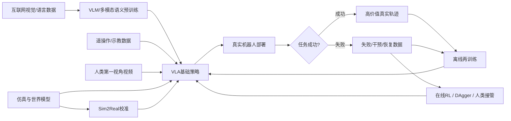
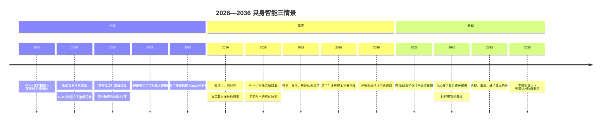

# 具身智能：为什么机器人还没有迎来自己的 ChatGPT 时刻？

为什么机器人还没有迎来自己的 ChatGPT 时刻？本文从真实交互数据、跨本体学习、实时控制、安全和单位经济性出发，梳理 VLA、世界模型、强化学习与 Sim2Real 的进展，并比较主要企业的技术路线、客户部署及财务证据。报告区分事实、推断与预测，提出面向2026—2036年的三种情景，以及衡量机器人能否进入规模化生产的关键指标。

<!-- more -->

!!! info "引用格式说明"
    原稿中的聊天引用标记已转为脚注，来源名称仅依据原稿附录整理。所提供文件没有附带原始网址，链接待补充；正文中的核查陈述属于原稿，本次发布仅完成格式整理，未新增事实核验。

**基准时间：2026年10月27日｜研究范围：机器人基础模型、VLA、世界模型、强化学习、Sim2Real、真实机器人商业化**

## 研究方法与检索策略

本报告采用**“原始来源优先、客户侧交叉验证、主动寻找反面证据、严格区分出货与生产性部署”**的方法。检索截止时间为 **2026年10月27日**。证据优先级依次为：

**P0：法定财务披露与监管文件**，包括 SEC、港交所、上交所，用于收入、亏损、销量、风险因素等硬数据；**P1：原始研究论文、官方技术报告、模型卡与数据集说明**，用于架构、训练数据、真实机器人实验和安全指标；**P2：官方 GitHub、开放模型与代码仓库**，用于判断技术是否真正可复现；**P3：客户和合作方官方材料**，用于验证所谓“部署”究竟是实验室演示、PoC 还是实际生产；**P4：IFR 等行业统计**；**P5：企业技术博客和新闻稿**，仅视为企业自报；**P6：Reuters 等权威媒体**，主要用于补充无法稳定抓取的 IPO 或非上市公司信息。IFR 最新的 World Robotics 2026 数据显示，2025年全球工业机器人安装量超过60万台，中国安装约35.4万台、占全球59%，美国约3.85万台；这为比较中美机器人产业基础提供了相对坚实的宏观基准。[^source-1][^source-2]

全文采用三个标识：

**〔事实 F〕**：可由原始文件、财务披露、论文或多源确认；  
**〔推断 I〕**：由公开事实推导，但不是企业或论文直接结论；  
**〔预测 P〕**：本报告对2026—2036年的情景判断。

同时定义四级部署成熟度：

| 等级 | 定义 | 本报告认定标准 |
|---|---|---|
| **L0 实验室演示** | 研究视频、展会、受控实验 | 没有真实客户生产责任 |
| **L1 客户 PoC / 试点** | 在真实客户场地测试 | 规模小、人工工程支持强、ROI未证实 |
| **L2 商业部署** | 已收费/交付并承担实际任务 | 有客户、收入或持续运行证据，但规模有限 |
| **L3 规模化生产部署** | 大量付费设备持续生产 | 应披露有效工时、利用率、故障率、干预率、续约/扩单等生产 KPI |

这里尤其要防止机器人行业最常见的统计错觉：**产量 ≠ 出货量 ≠ 客户验收 ≠ 生产性部署 ≠ 自主生产小时 ≠ 替代人工的经济价值**。Figure 的 BMW 项目之所以证据级别较高，并不是因为演示视频漂亮，而是 BMW 自己确认机器人在 Spartanburg 工厂参与实际 BMW X3 生产。[^source-3][^source-4]

## 执行摘要

**核心结论：机器人还没有迎来自己的 ChatGPT 时刻，不是因为缺少“大模型”，而是因为物理世界缺少互联网文本那种几乎免费的、统一格式的、可无限复制的数据，同时机器人必须解决实时闭环、接触力学、安全、硬件磨损和单位经济性。**

截至2026年10月，VLA 已经证明一件非常重要的事：**语言、视觉和低层动作可以被统一进同一个大规模学习框架**。π0 在预训练视觉语言模型之上加入连续动作专家并采用 flow matching；Octo 已在80万机器人轨迹上预训练；Open X-Embodiment 汇集60个数据集、34个研究实验室、22种机器人本体和超过100万条真实机器人轨迹。这说明“机器人基础模型”并不是概念，而是已经进入可扩展工程阶段。[^source-5][^source-6][^source-7]

但100万条机器人轨迹与互联网规模的数字数据仍处于完全不同的经济层级。机器人数据需要真实硬件、场地、操作者、物体、故障处理和安全监督；而且同一个动作在不同机械臂、关节极限、控制频率、夹爪和传感器上并不具有统一语义。这就是为什么 Open X-Embodiment 的真正价值不只是“100万”，而是尝试把异构机器人经验映射进共同的数据框架。[^source-8][^source-7]

2026年的第二个重要变化，是**人类视频开始成为机器人数据扩展的第二条路径**。Figure 的 Index 项目披露截至2026年8月已有约1600万段视频、4.4万周活跃贡献者；每1000小时视频覆盖约373种任务、1,146种被操作物体和116个环境。NVIDIA GR00T N1.7 则披露将约2万小时 EgoScale 人类视频与机器人示教数据结合。Physical Intelligence 的研究也表明，在机器人数据不足时加入第一视角人类数据能够明显改善机器人学习。[^source-9][^source-10][^source-11]

然而，这并没有消除“物理数据墙”。**人类视频提供的是“看到了什么、人在做什么”，而不是机器人真正需要的全部“关节状态—电机命令—接触力—摩擦—延迟—执行器温度—物体重量—失败后果”。**因此，人类视频更适合提供语义、任务结构和动作先验，而不能完全替代真实机器人交互。这也是为什么 Figure、NVIDIA、Physical Intelligence、Google 和智元都在同时建设真实机器人数据、仿真和世界模型，而不是押注视频单一路线。[^source-12][^source-13][^source-14][^source-15]

第三个趋势是**架构重新分层**。Google DeepMind 将 Gemini Robotics VLA 与 Gemini Robotics-ER 高层具身推理解耦：高层负责理解任务、空间关系、调用工具与规划，VLA 负责执行连续动作。Figure 的 Helix 02 进一步形成 System 2—System 1—System 0 层次，其中 System 0 负责全身快速动态控制。NVIDIA 则实际上形成了“GR00T VLA + Cosmos 世界模型 + Isaac 仿真 + Jetson/Thor 边缘计算”的完整物理 AI 平台。[^source-16][^source-12][^source-17]

这意味着“一个巨大的端到端模型包办所有事情”并没有成为2026年的主流生产架构。**慢速推理模型擅长理解和计划，快速动作模型擅长生成运动，最底层控制器负责毫秒级稳定性，独立安全系统负责紧急制动。**机器人行业正在重新发现传统机器人学长期坚持的事实：物理系统不能因为用了 Transformer 就取消实时控制和安全冗余。

反面证据尤其重要。NVIDIA 自己在 GR00T FAQ 中明确写道，N1.x 不是开放式推理/VQA 模型，当前开放机器人生态尚不存在真正意义上“零样本跨本体”的通用 VLA；无状态策略也不会天然知道任务失败后应该重试，通常仍需要 DAgger、RL 或其他数据闭环。[^source-18]

Google DeepMind 2026年7月发布的 Gemini Robotics 2 Safety Evaluations 则揭示了一个更本质的问题：在靠近人的机器人场景中，模型对“何时应该停止”存在**安全与生产效率的硬权衡**。报告发现，在某些配置下，把误停率控制在5%以下可能伴随超过40%的漏停率；而将漏停率压到约10%—15%又会显著增加不必要的停机。Google 因此明确提出，传统急停、速度/力限制等物理安全机制仍然是必需的。[^source-19][^source-20]

这与 ChatGPT 的产品环境完全不同。语言模型答错一句话可以重试；机器人漏判一次人类进入工作半径，可能意味着伤害、停线或法律责任。

商业化并非停滞。Figure 与 BMW 的 F02 项目已经是2026年少数能够被客户侧明确验证的案例：BMW 表示在约10个月内，Figure 机器人参与了3万辆 BMW X3 的生产，并执行每日约10小时工作班；Figure 自身披露累计运行超过1,250小时、搬运约9万件零部件。BMW 随后又确认了 Figure 03 的后续物流排序场景。[^source-21][^source-3][^source-4]

中国的商业数字则开始明显变硬。优必选2025年全尺寸具身智能人形机器人产品及服务收入约 **8.206亿元人民币**、销量 **1,079台**；2026年上半年该业务收入进一步达到 **5.903亿元**、销量 **921台**。同期优必选2026年上半年总营收12.691亿元、净亏损3.388亿元。也就是说，它已经不只是“订单故事”，但仍没有达到可以忽略亏损、维护和现场工程成本的程度。[^source-22][^source-23][^source-24]

宇树则展示了另一种中国优势：**极低硬件价格和快速制造规模化**。截至本报告检索日，官方渠道显示 R1 起价约4,900美元、G1约13,500美元、H2约29,900美元。其2025年营收约17亿元人民币，其中人形机器人约8.678亿元，并售出5,500多台人形机器人；但路透社依据招股材料同时指出，其实际工厂应用仍相对有限。这个反差极其重要：**“机器人销量爆发”并不自动等于“机器人劳动生产率爆发”。** [^source-25][^source-26][^source-27][^source-28]

因此，本报告的基准判断是：

> **受限工业、仓储、实验室等结构化场景，距离真正的“机器人 ChatGPT 时刻”约6—10年；开放家庭与城市环境中的通用、可靠、经济物理智能，大概率超过10年。**

这里的“ChatGPT时刻”不能用“机器人会多少种动作”定义，而应该同时满足：**广泛泛化、长时间自治、失败恢复、实时控制、安全可审计、低单位成本以及大规模付费生产部署。**

## 技术栈与“ChatGPT时刻”缺失的本质

### 机器人学习与大语言模型训练，本质上为什么不一样

| 维度 | 大语言模型 | 机器人基础模型 / VLA | 对规模化的影响 |
|---|---|---|---|
| 数据来源 | 文本、图像、代码天然数字化，可低成本复制 | 机器人轨迹需要硬件、场地、操作员和真实物体 | **物理数据的边际成本远高于 token** |
| 数据单位 | 相对统一的 token/序列 | RGB、深度、触觉、关节、末端位姿、力矩、连续动作 | 数据格式和本体高度异构 |
| 动作空间 | 输出 token | 连续高维控制量 | 需要动作归一化、本体条件化或动作专家 |
| 闭环 | 一段输出通常不改变现实世界 | 每个动作都会改变下一时刻观测 | 错误会累积，离线准确率不能代表闭环成功率 |
| 因果信息 | 大量语言共现就能学习很多知识 | 重量、摩擦、柔顺性、卡扣、接触力必须通过交互推断 | 被动视频无法完全替代交互 |
| 实时性 | 数百毫秒至秒级常可接受 | VLA约20—50Hz，底层控制常达数百Hz至1kHz | 云端大模型无法独立承担所有控制 |
| 失败成本 | 通常是错误答案 | 掉落、碰撞、设备损坏、人员受伤、停产 | 对可靠性要求比 demo 高多个数量级 |
| 评测 | 有大量统一静态基准 | 本体、环境、对象和控制器不统一 | 很难形成单一“排行榜时刻” |
| 部署成本 | 软件复制边际成本极低 | 每台设备都有 BOM、维护、标定、备件、电池 | 智能必须同时战胜物理经济性 |
| 数据飞轮 | 用户天然制造大量对话数据 | 用户不愿意让故障机器人在现实中“探索” | 在线RL受安全和成本限制 |

Open X-Embodiment 的100万+轨迹和 Octo 的80万轨迹已经代表一个重要台阶，但这些数据的本体、视角、动作空间和任务分布仍高度异质。与此同时，π0 之所以在 VLM 上再增加专门的连续动作专家，正说明“语言 token → 机器人动作”并非简单扩展词表即可解决。[^source-7][^source-29][^source-30]

这种差异可以用下面的数据飞轮表示：

**真正还没闭合的是 G → H → I/J → K 这部分。** LLM 的“用户使用 → 数据 → 再训练”几乎没有硬件边际成本，而机器人要在真实世界制造每一个失败样本。

### VLA：从“动作 token”向连续生成演化

Diffusion Policy 证明，机器人操作存在明显的多模态动作分布，同一个任务可能有多条正确动作路径；其研究在12个任务和4组机器人操作 benchmark 上，相比当时基线平均提高46.9%。π0 则进一步把 VLM 的互联网语义知识与 flow matching 连续动作生成结合。[^source-31][^source-5]

NVIDIA GR00T N1.7 采用约3B规模模型，由视觉语言部分与 diffusion transformer 动作头组成，并把摄像头、语言、机器人状态映射为连续 action chunks。官方仓库报告，在特定测试设置下其推理频率约为 RTX PRO 6000 Blackwell 上40Hz、Jetson AGX Thor 上28Hz。[^source-10]

Physical Intelligence 的机器人则通常以20Hz或50Hz运行。这类频率已经足以承担不少视觉操作策略，但仍明显不同于关节伺服或力控环；后者必须由更快的经典或学习控制器承担。[^source-32]

这解释了为什么未来通用机器人几乎必然是**多时间尺度系统**，而不是一颗 Transformer 从语音指令一路直接控制电机 PWM。

### 世界模型：机器人版“预训练世界”，但还不是物理定律

世界模型正在成为2026年的战略高地。

Google DeepMind 使用 Veo 世界模型预测机器人 policy 在正常、OOD 与安全场景中的表现，并用超过1,600次真实机器人评估、8个 policy checkpoint 与多个任务验证世界模型评估的相关性。其意义不是“Veo可以取代真机”，而是可以先在生成世界里筛掉大量明显糟糕的策略，再把昂贵的真实机器人评测预算用在最有价值的候选上。[^source-33]

NVIDIA 的 GR00T-Dreams 路线则让 Cosmos 生成机器人任务视频，再通过 inverse dynamics model 推断动作，从而制造带动作标签的训练数据；这实际上是在试图建立“物理 AI 的合成数据工厂”。[^source-13]

智元在2026年推出 GE-2 World Action Model，并与 GO-2、Genie Sim3.0 和分布式在线学习体系结合；优必选则在财报中披露 Thinker-WM 世界模型研发。[^source-15][^source-22]

但世界模型目前仍面临一个巨大陷阱：

> **视觉上的“像现实”不等于动力学上的“就是现实”。**

机械操作真正难的变量包括摩擦系数、接触刚度、软材料形变、绳子/布料拓扑、关节背隙、执行器饱和、电池电压下降、传感器噪声和温度漂移。世界模型可以非常擅长生成“看起来正确的视频”，但机器人真正需要的是**动作—力—状态转移的因果准确性**。

因此，〔推断 I〕未来世界模型最现实的定位不是替代真实机器人，而是：

**合成训练数据 + 长尾场景生成 + 策略预筛选 + 高层规划 + reward/model-based RL，再通过少量真机数据持续校准。**

### 强化学习：为什么重新变重要

机器人基础模型的第一阶段主要依赖 imitation learning，因为它安全、稳定而且能直接复制人类行为。但模仿学习有一个根本问题：**它只能把数据里已有的行为学好，很难主动超过示教者。**

Physical Intelligence 2026年的 RL Token 是一个值得关注的信号：他们冻结大型 VLA，将机器人状态压缩为 RL token，再让更小的 actor/critic 进行高吞吐 off-policy 更新，从而避免每一步强化学习都重新训练整个大模型。官方报告显示，在4类高精度任务中，仅用数小时甚至更少的真实交互即可改善策略，某些精细阶段速度最高约提升3倍，并能超过人工遥操作速度。[^source-34]

Figure Helix 02 的 System 0 则说明 RL 在全身控制中的另一个角色：其公司披露该控制层使用超过1,000小时人类运动数据，并结合 Sim2Real 强化学习，从而替代大量手写动态控制代码。[^source-12]

因此，未来最可能不是“imitation learning 或 RL 二选一”，而是：

**互联网/VLM预训练 → 大规模示教学习 → 仿真RL → 真实失败数据 → offline RL → 受安全约束的 online RL。**

至于 meta-RL，〔推断 I〕截至2026年它并没有成为前沿商业 VLA 的主干。工业界更倾向于上下文条件化、memory、少样本 fine-tuning、DAgger 和在线RL，因为这些方法更容易与现有大模型和数据管线结合。

### 实时延迟是隐藏的“推理税”

LLM 可以思考几秒钟，机器人不能。

Physical Intelligence 早期 π0/FAST 系统在生成一整个 action chunk 后再推理时，会造成控制停顿；Real-Time Chunking 的核心创新就是在机器人执行当前动作时异步计算下一段动作，并用 inpainting 把两个 chunk 平滑连接。官方实验显示该方法即使推理延迟超过300ms仍可以显著改善控制连续性。[^source-35]

Figure F03 也明确把摄像头帧率、视场和端到端视觉延迟作为硬件升级重点：公司称相机帧率提高2倍、延迟降低到此前约1/4，并增加指尖级力感知。[^source-36]

这意味着未来机器人 scaling law 不只是：

> 更多参数 + 更多数据 + 更多 FLOPs

而更接近：

> **更多有效交互数据 × 更低推理延迟 × 更高闭环频率 × 更高可靠性 × 更低硬件成本。**

## 企业技术路线、真实部署与财务证据对比

以下表格是本报告最核心的企业比较。**“公司自报”与“独立验证”明确分开。**

| 企业 | 模型/技术路线 | 数据与物理反馈 | 实时、泛化与安全 | 开源/最新研究 | 实际部署 | 财务与商业证据 | 评级 |
|---|---|---|---|---|---|---|---|
| **Google DeepMind** | Gemini Robotics 2 VLA + Gemini Robotics-ER 2 高层推理；分层执行；Veo世界模型 | 未完整公开训练规模；真实机器人+仿真+跨本体 | 官方强调跨本体适配、长任务、多机器人；安全评估明确揭示FNR/FPR权衡 | Gemini Robotics 2；ER-2；Veo policy evaluation；2026继续更新机器人模型 | **L0–L1**：研究演示、Boston Dynamics Spot等合作；无公开万台级运营 | Alphabet未单独披露机器人业务财务 | **A-：科研强、商业证据弱** |
| **NVIDIA** | GR00T N1.7 VLM+DiT动作头；Cosmos世界模型；Isaac；Jetson Thor | 20k小时EgoScale人类视频+机器人遥操作+合成数据 | N1.7约28–40Hz；官方承认无真正零样本跨本体；独立安全层加强 | Isaac-GR00T、GR00T-Dreams；N2仍为preview | **L2平台**：大量OEM/研究机构采用，但NVIDIA不是劳动力运营商 | FY27 Q2总营收962亿美元；机器人未单独披露 | **A：平台证据最完整** |
| **Figure AI** | Helix 02：System 2 + System 1 + System 0；全身端到端 | Index 1600万视频；System 0使用1000+h人类动作+Sim2Real RL | 公司称可连续4分钟完成洗碗；F03降低视觉延迟、加入力觉 | 闭源；主要技术博客而非可复现开放模型 | **L2**：BMW F02获BMW独立确认；F03继续进入工厂；Catalyst商业协议 | 私营，无审计营收；融资不能等同收入 | **A-/B+：部署强、透明度弱** |
| **Physical Intelligence** | π0/π0.5/π0.7；VLM+flow matching；RTC；memory；RL Token | 跨机器人+Web+人类视频+失败/次优数据 | 20/50Hz；RTC缓解300ms+延迟；π0.7强调可steer泛化 | π0.7论文；openpi；RL Token；RTC | **L0–L1**；2026 API Beta开放客户微调/推理 | 私营，无公开审计财务 | **A-：模型研究领先，商业早期** |
| **智元 AgiBot** | GO-1/GO-2；ViLLA Action-CoT；GE-2世界动作模型；Sim3.0 | AgiBot World Beta超过100万轨迹；另公开成功、失败、干预数据 | 真机+仿真+在线学习闭环突出 | AgiBot World / GO-1及2026新数据集 | **产量高、自治验证较早期**；公司称2026-06第15,000台下线，但同期公开G2工厂现场约100小时 | 私营，无公开审计财报 | **B+：数据开放强，规模自治证据不足** |
| **宇树 Unitree** | UnifoLM-WLA/WMA；RL运动控制；自有低成本本体 | 未披露同口径百万级操作轨迹 | 强运动控制、硬件迭代和价格；官方仍提醒行业处于早期 | UnifoLM、RL Lab、遥操作工具等 | **L2出货 / L1工厂自治**；2025人形销量5500+，但工厂应用仍有限 | 2025营收约17亿元，人形约8.678亿元；已IPO | **A-/B+：硬件商业化强** |
| **优必选 UBTECH** | Thinker、Thinker-WM、BrainNet 2.0、Co-Agent、多机器人协作 | 公司称生产线累计1亿+条工业数据，口径不是trajectory | 聚焦搬运、分拣、质检及群体协作 | Thinker 2026开源 | **L2**：2025 1,079台、2026H1 921台全尺寸具身人形 | 2025总营收20.01亿元；2026H1总营收12.69亿元，人形5.90亿元 | **A：财务证据强** |

### Google DeepMind：最像“机器人模型实验室”，而不是机器人制造商

Gemini Robotics 1.5 首次清晰展示了 Google 的双系统思路：VLA 将视觉和语言输入直接转为机器人动作，而 Gemini Robotics-ER 负责高层具身推理和工具调用。DeepMind 随后在2026年继续推出 ER 1.6、ER 2 和 Gemini Robotics 2，逐渐扩展到持续视频理解、任务进度跟踪、多机器人协调和全身 humanoid 控制。[^source-16][^source-37][^source-38]

DeepMind 对外宣称 Gemini Robotics 系列在综合泛化测试上明显超过此前VLA，并能较快适配新的双臂平台；不过这些数据主要来自内部评测，训练数据规模也没有像 Open X 或 AgiBot World 那样完全公开。[^source-39][^source-40]

因此 Google 当前真正的优势不是机器人生产规模，而是：

**最强多模态基础模型之一 + 世界模型 + 具身推理 + 安全研究 + 跨本体策略。**

它的核心风险则是：模型水平与现场商业化之间仍隔着本体制造、客户集成、售后和责任体系。

### NVIDIA：最可能赚到“卖铲子”的钱

NVIDIA 的路线与机器人整机厂完全不同：它希望控制**训练算力、世界模型、仿真、VLA、边缘芯片和开发工具**整个技术栈。

GR00T N1.7 是截至检索日最新公开成熟版本之一，约3B参数，输入包括多摄像头、自然语言和机器人状态，输出连续动作 chunk；公开仓库同时给出了 TensorRT 部署和 Jetson AGX Thor 支持。[^source-41][^source-10]

更值得注意的是 NVIDIA 自己公开的限制说明：N1.x 不是开放式通用推理系统，模型无状态，并不会自动知道“上一轮失败了，因此我要换一种办法”，真正跨本体零样本能力也仍未解决。[^source-18]

这比大量“机器人AGI即将到来”的营销口号更有分析价值。

NVIDIA 在2026年3月预告 GR00T N2，并宣称新架构在若干任务上获得超过2倍提升；但截至2026年10月27日，官方 FAQ 仍显示 N2 尚未作为成熟公开版本发布。因此本报告**不把N2宣传指标当作已经可部署的产品能力**。[^source-42][^source-18]

NVIDIA 的财务实力与任何纯机器人初创企业都不在同一量级。FY2027第二季度、截至2026年7月26日，公司营收达到 **962.21亿美元**；但 SEC 10-Q 中机器人并不是独立可报告分部，因此不能把 Edge Computing 或 Compute & Networking 的收入当作机器人收入。[^source-43][^source-44]

**投资含义：NVIDIA不需要押注某一家机器人公司获胜，只要越来越多机器人用 Isaac、Cosmos、GR00T 和 Jetson，它就能参与整个产业增长。**

### Figure AI：目前最重要的证据不是 Helix，而是 BMW

Figure Helix 02 的技术叙事很有吸引力：从视觉、触觉和本体感觉直接控制全身执行器，并让机器人完成约4分钟连续洗碗任务而不重置；System 0 使用1000+小时人类动作和Sim2Real RL。[^source-12]

但实验室厨房里的4分钟成功并不能证明工厂ROI。

真正改变 Figure 证据等级的是 BMW。BMW 官方确认，在 Spartanburg 工厂的约10个月部署中，Figure 机器人参与3万辆 BMW X3 生产，并进行每日约10小时工作班；之后 BMW 又确认继续测试 Figure 03，用于物流排序等新任务。[^source-3][^source-4]

Figure 还披露 F02 累计超过1,250运行小时、搬运9万件以上零部件；这些指标虽仍主要来自公司，但与 BMW 客户侧材料一致，因此可信度显著高于普通演示。[^source-21]

不过必须看到尺度：**1,250小时大约只是一个人几年工作量的数量级，不是百万小时自动驾驶车队式的现实数据规模。**

Figure 2026年8月推出 Index，是为了解决这个问题：其人类视频平台披露1600万视频、26.4万下载量和4.4万周活用户。[^source-9]

〔推断 I〕Figure 的真正长期赌注不是“先制造世界上最多机器人，再采数据”，而是**先利用智能手机把人类行为变成便宜的预训练数据，再让少量真机把人类先验映射到机器人动力学上。**

风险同样明显：Figure 的模型是封闭的，目前缺乏类似 Open X、Octo、GR00T 那样的第三方复现；公司为私营企业，没有可审核的机器人收入和毛利数据。

### Physical Intelligence：最纯粹的“机器人基础模型公司”

Physical Intelligence 是当前最值得与“OpenAI早期”类比的公司之一，但类比只能到“基础模型研究组织”为止，不能延伸到产品成熟度。

π0 的核心是预训练 VLM 加独立 action expert，用 flow matching 生成连续动作；π0.5 加强开放世界泛化和长程任务；2026年4月的 π0.7 强调通过多种 context 让同一 generalist policy 可被“steer”。[^source-5][^source-45][^source-46]

Physical Intelligence 的路线有三点值得重视：

第一，**不迷信纯机器人轨迹**，而是混合多机器人、Web、语义监督、人类视频、失败与次优数据。[^source-14]

第二，正面解决实时问题。Real-Time Chunking 针对 VLA 大模型的推理延迟设计异步 action chunk 机制。[^source-35]

第三，开始让 RL 接管“最后一公里”。RL Token 试图在不重新训练整个 VLA 的情况下，用少量真实在线数据优化精度和速度。[^source-34]

截至2026年10月，公司已经开放 API Beta，使客户可以上传数据、微调并通过云服务运行模型；这说明其商业模式正在从研究实验室转向“机器人 foundation-model API”，但尚没有证据表明它已经运营大规模生产机器人群。[^source-47]

### 智元机器人：最值得关注的是“数据工厂”

AgiBot World 是中国具身智能最重要的公开数据项目之一。公开仓库披露 Beta 数据已达到 **1,003,672条轨迹**，来自约100台机器人和100多个复制的现实场景，覆盖双臂、灵巧手等操作。[^source-48]

2026年智元进一步推出 GO-2、ViLLA Action-CoT、GE-2 World Action Model 与 Genie Sim3.0，并把在线学习纳入系统。[^source-15]

比成功轨迹更有价值的是它开始公开**失败数据和人工干预数据**。2026年的一组强化学习数据包括11,430条现实轨迹、1,024条成功 policy rollout、1,369条失败 rollout，以及大量错误和人工干预片段。[^source-49]

这非常重要，因为未来机器人模型真正的护城河可能不是“收集最多成功示教”，而是：

> **谁拥有最多具有因果价值的失败—恢复—人工介入序列。**

智元宣布2026年6月第15,000台机器人下线，这是制造能力的重要里程碑；但同一官方材料中，G2在工厂真实现场的累计运行约100小时。[^source-50]

这组数字恰恰是本报告强调“主动找反面证据”的最好例子：

**15,000台制造量非常强，但100小时生产现场验证又说明通用自治还非常年轻。两者并不矛盾。**

### 宇树：最强优势是“身体的摩尔定律”

宇树的战略意义不只在于舞蹈、跑步和武术，而在于它正在极快降低具身研究的**硬件入场成本**。

截至2026年10月的官方价格：

- R1 AIR 约 **4,900美元**，R1约5,900美元；[^source-25]
- G1官方商店约 **13,500美元**；[^source-51]
- H2约 **29,900美元**；H2 Plus约100,000美元。[^source-26][^source-52]

H2还提供约31自由度和最高360 N·m级关节扭矩等规格；宇树产品页同时明确警示，人形机器人行业仍处于早期探索阶段。[^source-53][^source-54]

2025年公司营收约17亿元人民币，人形机器人收入约8.678亿元，首次超过四足机器人业务；2025年人形机器人销量超过5,500台。2026年第一季度营收约4.228亿元，同比增长68.5%，但扣除一次性因素后的利润因研发和营销投入增长而明显下降。[^source-27][^source-28]

反面证据是，路透社依据上市材料指出，**实际工厂应用仍然有限**，不少销量仍来自科研、教育、展示等场景。[^source-28]

这意味着宇树已经证明：

> **人形机器人“身体”可以迅速消费电子化。**

但还没有证明：

> **一个1万美元级身体已经可以稳定产出相当于一个工人的劳动价值。**

这是两个完全不同的里程碑。

### 优必选：目前中国最有价值的商业验证之一

优必选因为已经上市，给行业提供了罕见的真实财务窗口。

2025年，公司总营收约 **20.010亿元人民币**，同比增长53.3%；其中全尺寸具身智能人形机器人产品与服务收入 **8.206亿元**，从2024年的3,562万元大幅增长，销量达到 **1,079台**。公司2025年整体毛利率达到37.7%，但全年仍亏损约 **7.898亿元**。[^source-22][^source-55][^source-56]

2026年上半年，公司总营收进一步达到 **12.691亿元**，同比增长104.2%；全尺寸具身人形业务收入 **5.903亿元**，销量 **921台**；同期净亏损约 **3.388亿元**。[^source-23][^source-24]

技术上，优必选将 Thinker、Thinker-WM、BrainNet 2.0 和 Co-Agent 组合到工业机器人系统，并在2026年开源 Thinker 视觉语言基础模型。[^source-57][^source-58]

公司还称，其机器人已经积累超过1亿条工业制造场景数据。需要强调，这里的口径是 **“pieces of data”**，不是标准化机器人 trajectory，因此不能拿“1亿”直接与 AgiBot World 的“100万轨迹”比较。[^source-22][^source-59]

这正是当前行业数据宣传最容易误导投资者的地方。

## 中美对比、产业经济性与机会

### 中国与美国的结构性优势并不相同

| 维度 | 美国 | 中国 | 本报告判断 |
|---|---|---|---|
| **基础模型** | Google、NVIDIA、PI在VLM/VLA、世界模型、AI research上领先 | 追赶极快，智元/宇树/优必选已经形成独立模型体系 | **美国当前领先** |
| **训练算力/芯片生态** | NVIDIA、CUDA、Blackwell/Thor形成巨大优势 | 高端训练计算受出口管制约束，但边缘侧选择更多 | **美国明显领先** |
| **机器人数据** | 顶尖实验室质量高，Figure等探索人类视频规模化 | 工厂密度高、OEM多、真实工业场景丰富 | **中国具有潜在数据场优势** |
| **摄像头/LiDAR/IMU** | 高端算法融合和研发强 | EV、消费电子供应链带来规模和成本优势 | **中国成本侧占优** |
| **触觉传感器** | 研究领先、初创生态强 | 量产追赶快 | **全球都未形成绝对赢家** |
| **电机/驱动/结构件** | 高性能控制强，但成本较高 | 完整制造供应链、快速迭代、规模降本 | **中国明显占优** |
| **灵巧手/执行器** | 高端方案强 | 供应链密集、价格下降更快 | **中国量产优势扩大** |
| **工业客户池** | 2025工业机器人安装约3.85万台 | 2025约35.4万台，占全球59% | **中国压倒性规模优势** |
| **软件生态** | CUDA、Isaac、ROS周边、基础模型资本生态强 | 快速建立国产栈，但碎片化更明显 | **美国领先** |
| **整机制造成本** | Figure等尚未公开大规模售价 | Unitree已将部分人形价格拉到0.5万—3万美元 | **中国领先** |
| **商业验证** | Figure-BMW质量高但案例数不多 | UBTECH、Unitree、AgiBot等出货量大 | **中国量，美国部分场景质量** |

IFR最新统计尤其说明制造生态差异：2025年中国部署约35.4万台工业机器人，占全球59%；中国本土供应商在国内安装约19.5万台，市场份额约55%。美国同年约3.85万台，是全球第二大市场，但规模只有中国大约十分之一。[^source-1]

这个差距对于具身智能的重要性可能被低估。

LLM 的“训练场”是互联网；机器人的训练场就是**工厂、仓库、家庭、实验室和真实物体**。

因此，〔推断 I〕如果未来的 scaling law 越来越依赖真实交互而不是互联网数据，中国庞大的制造场景可能逐步成为类似“物理互联网”的战略资产。

但美国的算力优势同样不能低估。NVIDIA 的 SEC 文件明确指出，美国出口管制已经实质影响其在中国高端数据中心计算市场的参与。虽然机器人边缘芯片并不等同于数据中心 GPU，但前沿 VLA 和世界模型的训练能力仍会受到整个高端计算生态的影响。[^source-44]

因此更可能出现的是：

**美国：脑、算力、世界模型、软件平台优势；**  
**中国：身体、执行器、供应链、制造场景、整机成本优势。**

最终胜负取决于谁能最快把这两侧连接成真实数据飞轮。

### 为什么售价下降仍不等于商业成熟

Unitree R1 的4,900美元价格很容易让人产生一个错觉：“既然本体已经比汽车便宜，人形机器人马上就会普及。”

问题是机器人不是一次性资本品，而是一个**持续运行服务系统**。

真正单位经济性应计算：

\[
\text{每有效生产小时TCO}
=
\frac{
\text{购置成本}
+\text{集成}
+\text{维护}
+\text{备件}
+\text{能源}
+\text{远程接管}
+\text{现场工程}
+\text{停线风险}
}{
\text{真正自主完成工作的有效小时}
}
\]

假设两个机器人：

机器人 A 售价3万美元，但一年只有1000小时真正无人干预的有效生产；  
机器人 B 售价8万美元，但一年能可靠运行5000小时。

即使不考虑其他成本，A的资本成本摊销就可能高于B。

因此，**投资者最该追踪的不是“BOM已经降到多少”，而是 autonomy-adjusted utilization——经过自主率调整后的有效利用率。**

Figure F03 的无线充电、电池、相机、执行器和制造工艺改进之所以重要，也不是因为单一参数更漂亮，而是这些改进最终都有可能提升有效生产小时、降低人工维护。Figure 称其 F03 电池达到约2.3kWh、典型峰值工作约5小时，并较 F02 大幅降低电池成本；但仍应视为公司自报，需要客户运营数据进一步验证。[^source-60][^source-36]

### 就业机会：最值钱的不是“机器人Prompt工程师”

对于大学生或准备进入这个行业的人，〔推断 I〕未来5—10年最稀缺的能力会集中在**连接AI与真实世界的接口层**：

| 方向 | 技术壁垒 | 机会判断 |
|---|---:|---|
| **机器人数据工程** | 高 | ⭐⭐⭐⭐⭐ |
| **遥操作/示教系统** | 高 | ⭐⭐⭐⭐ |
| **VLA训练与后训练** | 很高 | ⭐⭐⭐⭐⭐ |
| **强化学习 / offline-online RL** | 很高 | ⭐⭐⭐⭐⭐ |
| **Sim2Real / 仿真平台** | 高 | ⭐⭐⭐⭐⭐ |
| **运动控制 / Whole-body control** | 很高 | ⭐⭐⭐⭐⭐ |
| **灵巧手/触觉** | 很高 | ⭐⭐⭐⭐⭐ |
| **安全验证/独立Benchmark** | 高且供给少 | ⭐⭐⭐⭐⭐ |
| **边缘模型压缩与实时推理** | 很高 | ⭐⭐⭐⭐⭐ |
| **机器人售前/现场集成** | 中高 | ⭐⭐⭐⭐ |
| 单纯“提示词工程” | 低 | ⭐⭐ |

原因很简单：互联网AI里已经解决的问题不是机器人行业最缺的问题。机器人行业现在最缺的是**怎样让一个80%成功率的模型变成99.9%可靠的生产系统**。

对于计算机专业学生，一个非常强的组合是：

**PyTorch/JAX + Transformer/VLM + ROS2 + MuJoCo/Isaac Lab + RL + C++实时系统 + 一项真实机器人硬件经验。**

对于机械/自动化专业，则应避免只停留在传统 PID 和机械设计，最好叠加：

**运动控制 + 状态估计 + imitation/RL + 数据工程 + GPU推理。**

### 创业机会：不要轻易再造一个“通用人形机器人公司”

从资本效率看，2026年重新成立一家完整 humanoid OEM，通常需要同时解决：

机械结构、关节、电池、驱动器、传感器、手、低层控制、VLA、数据、仿真、安全、供应链、售后和销售。

这几乎是最资本密集的AI创业方向之一。

更合理的创业楔子是解决一个高频瓶颈：

**第一类：机器人数据基础设施。**  
低成本遥操作、自动标注、失败数据挖掘、数据质量评分、跨本体动作标准化。

**第二类：远程接管与自动恢复。**  
工业客户真正需要的不是“永远不失败”，而是“失败后30秒内恢复，而且一个人可以监督几十台机器人”。

**第三类：Sim2Real 与世界模型验证。**  
重点不是做更漂亮的视频生成，而是测量 synthetic policy 在真实机器人上的 transfer gap。

**第四类：灵巧手、触觉、力控。**  
通用机器人当前最大的物理瓶颈之一不是走路，而是稳定地拿、插、拧、拉、折、剥、装。

**第五类：垂直 RaaS。**  
不要一开始卖“通用机器人”，而是卖“一个能够替代某工位每班两个人的结果”。当某工位产生大量独有数据后，再横向扩展技能。

### 投资机会：最重要的不是预测哪家“AGI机器人”赢

投资组合可以用“杠铃”思路：

一端是**卖铲子的基础设施**：GPU/边缘芯片、执行器、减速器、触觉、灵巧手、仿真、数据基础设施、安全测试。

另一端是**拥有真实付费生产数据的机器人公司**。

尽调时建议至少要求以下数据，而不是只看演示视频：

| 指标 | 为什么比“演示成功率”更重要 |
|---|---|
| **客户现场累计自主小时** | 最直接证明真实可靠性 |
| **每8小时人工介入次数** | 决定是否真的节省劳动 |
| **MTBF / MTTR** | 决定维护和停线成本 |
| **任务成功率及置信区间** | 不能只展示最佳视频 |
| **OOD环境成功率** | 衡量真实泛化 |
| **自主恢复率** | 失败不可避免，恢复能力更关键 |
| **有效利用率** | 决定设备是否值得买 |
| **确认收入而非订单** | 订单可取消，收入意味着验收 |
| **扣除现场工程后的毛利** | 防止“AI服务收入实际上是人肉驻场” |
| **客户扩单率** | 最强ROI证据之一 |

**红旗**包括：“计划年产10万台”“累计订单100亿元”“已与几十家车企合作”“发布100种技能”“全球领先benchmark”，但不披露生产性自主小时和人工介入率。

Figure 的 BMW 数据、UBTECH 的单列人形业务收入，证据价值都远高于纯订单和产能数字。[^source-3][^source-23]

## 2026—2036情景、量化里程碑与最终结论

### 三种情景

**〔预测 P｜乐观情景〕**

2027—2028年，VLA + 世界模型 + 在线RL形成更有效闭环；新机器人任务从过去数百/数千次遥操作示教下降到几十次示教或人类视频+少量真机校准。

2028—2030年，在仓储、汽车零部件、电子制造和实验室中出现大量**连续1—8小时低人工介入**系统。

2030—2033年，单一机器人能够在同一工厂跨几十到几百种技能切换，典型项目投资回收期下降至2年以内。

2033—2036年，在**受限工作域**出现真正意义的机器人 ChatGPT 时刻：用户不再为每个动作写程序，而是通过自然语言和几分钟示教让机器人完成新任务。

开放家庭仍晚于工业，但可能在2035年前后出现第一批真正有经济意义的家务平台。

**〔预测 P｜基准情景〕**

2027—2029年模型 benchmark 快速提高，但最后10%的可靠性仍昂贵。

2029—2032年，机器人可在部分结构化岗位实现4—8小时连续工作，但每进入一个新工厂仍需数小时至数十小时数据采集和工程适配。

2032—2035年，失败恢复、安全验证、远程接管和维护体系逐渐成熟，生产部署规模显著扩大。

到2036年，工业和物流出现大量“半通用工人机器人”，但普通家庭机器人仍做不到“看到任何新房子、听懂任意家务、第一次就可靠完成”。

**〔预测 P｜悲观情景〕**

世界模型视觉能力持续提高，但接触物理精度改善慢；RL真实探索受到安全限制。

2028—2031年，大量机器人仍依赖人工远程接管，导致“所谓自主机器人”实际上是昂贵的远程劳动平台。

2031—2034年，事故责任、认证、维护和保险成本明显抬升。

到2036年，行业主流仍是“专用自动化设备 + VLA增强”，而不是通用 humanoid labor。

### Mermaid 关键时间线

### 到底什么指标出现，才能说“机器人 ChatGPT 时刻到了”？

本报告建议不用参数量、benchmark 或“技能数量”作为定义，而使用以下六项同时达标：

| 维度 | 本报告提出的里程碑 | 2026状态 |
|---|---|---|
| **泛化** | ≥1,000个未见任务/对象组合、≥10类真实环境、≥3种本体；零/少样本平均成功率≥90% | **未达到统一独立验证** |
| **可靠性** | 8小时班次人工介入≤1次；核心任务成功率≥99.5% | **距离较大** |
| **失败恢复** | ≥95%常见可恢复故障无需人工 | **公开数据极少** |
| **实时控制** | 高层推理不阻塞20—50Hz动作策略；500Hz—1kHz底层安全/力控 | **技术上正在达到** |
| **经济性** | 真实TCO低于替代人力/专机；典型ROI <2年 | **仅部分工位可能达到** |
| **规模化** | ≥10,000台付费机器人持续生产，并披露利用率、介入率和故障率 | **产量/销量接近，自治KPI尚未接近** |

其中实时控制是进展最快的一项：NVIDIA N1.7 已报告约28—40Hz级推理，Physical Intelligence系统常运行在20/50Hz；NVIDIA新参考硬件又把底层力控推向1kHz级。[^source-10][^source-32][^source-17]

真正困难的是**可靠性×时间**。

假设一个看起来非常强的机器人每个独立操作成功率达到99%。如果一天需要连续执行1,000个关键操作，简单独立假设下“全部不失败”的概率为：

\[
0.99^{1000}\approx0.0043\%
\]

即便这个独立假设非常简化，它仍说明工业机器人需要思考的不是“99%是不是很高”，而是：

**失败是否可检测、是否可恢复、失败是否会损坏环境，以及一个班次到底要叫几次人。**

这就是机器人与聊天机器人最深的产品差异。

### 最终判断：机器人究竟还有多远？

**〔事实 F〕科学问题已经从“VLA能不能工作”转向“VLA能不能规模化工作”。** π0、Gemini Robotics、GR00T、Helix、AgiBot、Thinker 等已经反复证明，通用视觉语言知识能够转化为机器人控制能力。[^source-5][^source-39][^source-10][^source-12][^source-15][^source-57]

**〔事实 F〕硬件成本也不再是不可逾越的六位数美元壁垒。** 中国厂商已经把部分可开发 humanoid 平台价格推到几千至几万美元。[^source-25][^source-26]

**〔事实 F〕现实商业价值已经出现。** BMW—Figure、UBTECH工业人形收入、Unitree规模销量，都证明这不是纯学术泡沫。[^source-3][^source-23][^source-27]

但：

**〔事实 F〕零样本跨本体、长时间可靠自治、失败恢复、独立安全认证和透明单位经济性仍未同时解决。** NVIDIA 自己明确承认跨本体零样本的限制，Google 的安全实验则揭示安全—效率之间尚未消除的权衡。[^source-18][^source-20][^source-61]

所以本报告最终给出的量化时间判断是：

> **结构化工业、仓储、实验室中的“通用工位机器人”：约3—6年进入快速扩张期。**

> **受限工作域中真正类似 ChatGPT 的低门槛通用物理智能：约6—10年，即大致2032—2036年。**

> **能够进入陌生家庭，在儿童、宠物、杂物、柔性物、未知家具和开放自然语言下仍然可靠安全运行的真正通用机器人：基准情景超过10年，很可能晚于2036年。**

最值得监测的不是某家公司下一次发布会，而是三个数字：

**真实机器人产生的数据是否开始主要来自自主运行，而不是人工遥操作；**

**每8小时工作班次的人工介入次数是否下降到1次以下；**

**客户在把维护、远程接管、折旧和停机全部算进去后，是否仍愿意规模扩单。**

当这三个条件同时出现时，机器人行业才真正跨过了 ChatGPT 时刻。

在此之前，2026年的具身智能更准确的定义是：

> **“GPT-3之后、ChatGPT之前”的机器人时代——基础模型范式已经基本成立，数据飞轮、可靠性和产品经济性尚未完成最后的闭环。**

## 附录：关键论文、开源项目、财务与核查来源

以下按本报告实际证据优先级排列，均核查至 **2026年10月27日**。

| 优先级 | 来源/项目 | 主要用途 |
|---|---|---|
| **P0** | NVIDIA FY27 Q2 财务与 SEC 10-Q | 财务规模、业务分部、出口管制；机器人收入并未单独披露。[^source-43][^source-62] |
| **P0** | UBTECH 2025年报 / 2026半年报 | 人形收入、销量、净亏损、工业数据等。[^source-22][^source-23][^source-24] |
| **P0/P6** | Unitree IPO/招股材料交叉核验 | 2025收入、人形收入、销量和工厂应用限制。[^source-27][^source-28] |
| **P1** | Open X-Embodiment / RT-X | 60数据集、34实验室、22本体、100万+真实轨迹。[^source-8][^source-7] |
| **P1** | Octo | 80万轨迹开放通用机器人策略。[^source-6][^source-29] |
| **P1** | π0 | VLM + flow-matching action expert。[^source-5][^source-30] |
| **P1** | π0.7 | 2026年可steer generalist foundation model。[^source-46] |
| **P1** | Diffusion Policy | 生成式连续动作策略的关键基础工作。[^source-31] |
| **P1** | Gemini Robotics 2 Safety Evaluations | 真实安全问题、近人监测、FNR/FPR、安全冗余。[^source-19][^source-20][^source-61] |
| **P1** | Gemini Robotics / Robotics-ER | Google双层具身模型体系。[^source-39][^source-16][^source-38] |
| **P1** | Evaluating Gemini Robotics Policies in a Veo World Model | 世界模型作为策略评估器的真实机器人实验。[^source-33] |
| **P2** | NVIDIA Isaac-GR00T N1.7 | 3B开放VLA、数据构成、28/40Hz推理。[^source-10] |
| **P2** | NVIDIA GR00T-Dreams | Cosmos世界模型→视频→逆动力学→动作数据。[^source-13] |
| **P2** | NVIDIA GR00T FAQ | 极重要反面证据：无真正零样本跨本体、无状态不自动重试。[^source-18] |
| **P1/P2** | Physical Intelligence openpi / RTC / RL Token | 开放VLA、实时控制和在线RL。[^source-63][^source-35][^source-34] |
| **P2** | AgiBot World | 100万+真实轨迹、中国最重要开放具身数据之一。[^source-48] |
| **P1/P2** | AgiBot 2026 GO-2 / GE-2 / Sim3.0 | VLA + 世界动作模型 + 仿真 + 在线学习。[^source-15] |
| **P2** | AgiBot RL Dataset | 真实成功、失败、干预数据。[^source-49] |
| **P2** | UBTECH Thinker | 2026年开源具身视觉语言基础模型。[^source-57] |
| **P2** | Unitree UnifoLM/WLA及RL生态 | 宇树具身模型与硬件开发生态。[^source-64][^source-65] |
| **P3** | BMW 官方材料 | Figure实际工厂部署最关键独立证据。[^source-3][^source-4] |
| **P4** | IFR World Robotics 2026 | 中国35.4万、美国约3.85万等工业机器人产业数据。[^source-1][^source-2] |
| **P5** | Figure Helix 02 | System 0/1/2架构和公司侧机器人实验。[^source-12] |
| **P5** | Figure Index | 1600万人类视频数据扩展战略。[^source-9] |
| **P5** | Unitree官方产品与商店 | R1/G1/H2当前售价与硬件成本趋势。[^source-25][^source-26] |

**核查限制。** Google DeepMind、Figure AI 和 Physical Intelligence 没有公开可与上市公司同口径比较的独立机器人业务财务；Figure 和 Physical Intelligence 是私营公司，因此融资额和估值不能被当成收入。NVIDIA 虽有完整上市公司财报，但机器人业务没有独立收入分部，因此本报告没有将其962亿美元季度收入或72亿美元 Edge Computing 收入错误归为“机器人收入”。[^source-43][^source-66][^source-44]

对于 Unitree，本报告的2025—2026财务数字以招股文件相关公开报道和交易所信息交叉验证；由于本次检索环境对部分上交所原始 PDF 抓取不稳定，数字采用“约”而不是虚构出更高精度。[^source-27][^source-28]

对于 Figure、AgiBot 等公司自报的模型成功率、产量和实验结果，本报告均没有自动升级为“规模化部署”。例如 Figure 的 BMW 部署因为获得客户 BMW 独立确认，证据等级显著高于普通公司视频；而智元“15,000台下线”与其披露约100小时 G2 工厂运行同时保留，以避免把制造规模错误解释为自主生产能力。[^source-3][^source-50]

最终，行业最缺的仍不是另一个宣传 benchmark，而是一个所有厂商都无法规避的统一测试体系：**未知环境、未知对象、连续8小时、记录所有失败、记录所有人工介入、统计安全事件、统计维护成本，并由独立第三方执行。** 在这种 benchmark 真正普及之前，对“机器人已经迎来ChatGPT时刻”的任何结论，都应保持高度谨慎。

## 引用脚注

[^source-1]: IFR World Robotics 2026。原始网址未随 Markdown 文件提供，待补充；本次发布未重新核查。

[^source-2]: IFR World Robotics 2026。原始网址未随 Markdown 文件提供，待补充；本次发布未重新核查。

[^source-3]: BMW 官方材料。原始网址未随 Markdown 文件提供，待补充；本次发布未重新核查。

[^source-4]: BMW 官方材料。原始网址未随 Markdown 文件提供，待补充；本次发布未重新核查。

[^source-5]: π0。原始网址未随 Markdown 文件提供，待补充；本次发布未重新核查。

[^source-6]: Octo。原始网址未随 Markdown 文件提供，待补充；本次发布未重新核查。

[^source-7]: Open X-Embodiment / RT-X。原始网址未随 Markdown 文件提供，待补充；本次发布未重新核查。

[^source-8]: Open X-Embodiment / RT-X。原始网址未随 Markdown 文件提供，待补充；本次发布未重新核查。

[^source-9]: Figure Index。原始网址未随 Markdown 文件提供，待补充；本次发布未重新核查。

[^source-10]: NVIDIA Isaac-GR00T N1.7。原始网址未随 Markdown 文件提供，待补充；本次发布未重新核查。

[^source-11]: 原稿引用（未在附录中找到可对应的完整书目信息）。原始网址未随 Markdown 文件提供，待补充；本次发布未重新核查。

[^source-12]: Figure Helix 02。原始网址未随 Markdown 文件提供，待补充；本次发布未重新核查。

[^source-13]: NVIDIA GR00T-Dreams。原始网址未随 Markdown 文件提供，待补充；本次发布未重新核查。

[^source-14]: 原稿引用（未在附录中找到可对应的完整书目信息）。原始网址未随 Markdown 文件提供，待补充；本次发布未重新核查。

[^source-15]: AgiBot 2026 GO-2 / GE-2 / Sim3.0。原始网址未随 Markdown 文件提供，待补充；本次发布未重新核查。

[^source-16]: Gemini Robotics / Robotics-ER。原始网址未随 Markdown 文件提供，待补充；本次发布未重新核查。

[^source-17]: 原稿引用（未在附录中找到可对应的完整书目信息）。原始网址未随 Markdown 文件提供，待补充；本次发布未重新核查。

[^source-18]: NVIDIA GR00T FAQ。原始网址未随 Markdown 文件提供，待补充；本次发布未重新核查。

[^source-19]: Gemini Robotics 2 Safety Evaluations。原始网址未随 Markdown 文件提供，待补充；本次发布未重新核查。

[^source-20]: Gemini Robotics 2 Safety Evaluations。原始网址未随 Markdown 文件提供，待补充；本次发布未重新核查。

[^source-21]: 原稿引用（未在附录中找到可对应的完整书目信息）。原始网址未随 Markdown 文件提供，待补充；本次发布未重新核查。

[^source-22]: UBTECH 2025年报 / 2026半年报。原始网址未随 Markdown 文件提供，待补充；本次发布未重新核查。

[^source-23]: UBTECH 2025年报 / 2026半年报。原始网址未随 Markdown 文件提供，待补充；本次发布未重新核查。

[^source-24]: UBTECH 2025年报 / 2026半年报。原始网址未随 Markdown 文件提供，待补充；本次发布未重新核查。

[^source-25]: Unitree官方产品与商店。原始网址未随 Markdown 文件提供，待补充；本次发布未重新核查。

[^source-26]: Unitree官方产品与商店。原始网址未随 Markdown 文件提供，待补充；本次发布未重新核查。

[^source-27]: Unitree IPO/招股材料交叉核验。原始网址未随 Markdown 文件提供，待补充；本次发布未重新核查。

[^source-28]: Unitree IPO/招股材料交叉核验。原始网址未随 Markdown 文件提供，待补充；本次发布未重新核查。

[^source-29]: Octo。原始网址未随 Markdown 文件提供，待补充；本次发布未重新核查。

[^source-30]: π0。原始网址未随 Markdown 文件提供，待补充；本次发布未重新核查。

[^source-31]: Diffusion Policy。原始网址未随 Markdown 文件提供，待补充；本次发布未重新核查。

[^source-32]: 原稿引用（未在附录中找到可对应的完整书目信息）。原始网址未随 Markdown 文件提供，待补充；本次发布未重新核查。

[^source-33]: Evaluating Gemini Robotics Policies in a Veo World Model。原始网址未随 Markdown 文件提供，待补充；本次发布未重新核查。

[^source-34]: Physical Intelligence openpi / RTC / RL Token。原始网址未随 Markdown 文件提供，待补充；本次发布未重新核查。

[^source-35]: Physical Intelligence openpi / RTC / RL Token。原始网址未随 Markdown 文件提供，待补充；本次发布未重新核查。

[^source-36]: 原稿引用（未在附录中找到可对应的完整书目信息）。原始网址未随 Markdown 文件提供，待补充；本次发布未重新核查。

[^source-37]: 原稿引用（未在附录中找到可对应的完整书目信息）。原始网址未随 Markdown 文件提供，待补充；本次发布未重新核查。

[^source-38]: Gemini Robotics / Robotics-ER。原始网址未随 Markdown 文件提供，待补充；本次发布未重新核查。

[^source-39]: Gemini Robotics / Robotics-ER。原始网址未随 Markdown 文件提供，待补充；本次发布未重新核查。

[^source-40]: 原稿引用（未在附录中找到可对应的完整书目信息）。原始网址未随 Markdown 文件提供，待补充；本次发布未重新核查。

[^source-41]: 原稿引用（未在附录中找到可对应的完整书目信息）。原始网址未随 Markdown 文件提供，待补充；本次发布未重新核查。

[^source-42]: 原稿引用（未在附录中找到可对应的完整书目信息）。原始网址未随 Markdown 文件提供，待补充；本次发布未重新核查。

[^source-43]: NVIDIA FY27 Q2 财务与 SEC 10-Q。原始网址未随 Markdown 文件提供，待补充；本次发布未重新核查。

[^source-44]: 原稿引用（未在附录中找到可对应的完整书目信息）。原始网址未随 Markdown 文件提供，待补充；本次发布未重新核查。

[^source-45]: 原稿引用（未在附录中找到可对应的完整书目信息）。原始网址未随 Markdown 文件提供，待补充；本次发布未重新核查。

[^source-46]: π0.7。原始网址未随 Markdown 文件提供，待补充；本次发布未重新核查。

[^source-47]: 原稿引用（未在附录中找到可对应的完整书目信息）。原始网址未随 Markdown 文件提供，待补充；本次发布未重新核查。

[^source-48]: AgiBot World。原始网址未随 Markdown 文件提供，待补充；本次发布未重新核查。

[^source-49]: AgiBot RL Dataset。原始网址未随 Markdown 文件提供，待补充；本次发布未重新核查。

[^source-50]: 原稿引用（未在附录中找到可对应的完整书目信息）。原始网址未随 Markdown 文件提供，待补充；本次发布未重新核查。

[^source-51]: 原稿引用（未在附录中找到可对应的完整书目信息）。原始网址未随 Markdown 文件提供，待补充；本次发布未重新核查。

[^source-52]: 原稿引用（未在附录中找到可对应的完整书目信息）。原始网址未随 Markdown 文件提供，待补充；本次发布未重新核查。

[^source-53]: 原稿引用（未在附录中找到可对应的完整书目信息）。原始网址未随 Markdown 文件提供，待补充；本次发布未重新核查。

[^source-54]: 原稿引用（未在附录中找到可对应的完整书目信息）。原始网址未随 Markdown 文件提供，待补充；本次发布未重新核查。

[^source-55]: 原稿引用（未在附录中找到可对应的完整书目信息）。原始网址未随 Markdown 文件提供，待补充；本次发布未重新核查。

[^source-56]: 原稿引用（未在附录中找到可对应的完整书目信息）。原始网址未随 Markdown 文件提供，待补充；本次发布未重新核查。

[^source-57]: UBTECH Thinker。原始网址未随 Markdown 文件提供，待补充；本次发布未重新核查。

[^source-58]: 原稿引用（未在附录中找到可对应的完整书目信息）。原始网址未随 Markdown 文件提供，待补充；本次发布未重新核查。

[^source-59]: 原稿引用（未在附录中找到可对应的完整书目信息）。原始网址未随 Markdown 文件提供，待补充；本次发布未重新核查。

[^source-60]: 原稿引用（未在附录中找到可对应的完整书目信息）。原始网址未随 Markdown 文件提供，待补充；本次发布未重新核查。

[^source-61]: Gemini Robotics 2 Safety Evaluations。原始网址未随 Markdown 文件提供，待补充；本次发布未重新核查。

[^source-62]: NVIDIA FY27 Q2 财务与 SEC 10-Q。原始网址未随 Markdown 文件提供，待补充；本次发布未重新核查。

[^source-63]: Physical Intelligence openpi / RTC / RL Token。原始网址未随 Markdown 文件提供，待补充；本次发布未重新核查。

[^source-64]: Unitree UnifoLM/WLA及RL生态。原始网址未随 Markdown 文件提供，待补充；本次发布未重新核查。

[^source-65]: Unitree UnifoLM/WLA及RL生态。原始网址未随 Markdown 文件提供，待补充；本次发布未重新核查。

[^source-66]: 原稿引用（未在附录中找到可对应的完整书目信息）。原始网址未随 Markdown 文件提供，待补充；本次发布未重新核查。
