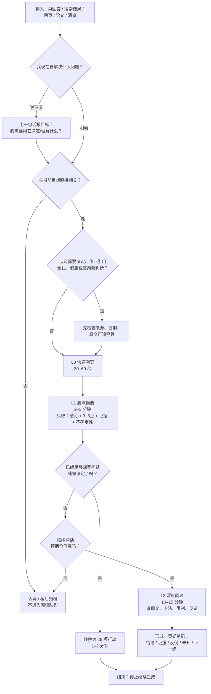

# 面对 AI 海量且繁杂信息时的阅读抗拒：原因、干预与可执行工作流

面对 AI 输出的大量信息，阅读抗拒往往与处理成本、验证成本和价值密度失衡有关。本文从认知负荷、信息过载、任务切换及模型生成机制出发，整理读前筛选、分层阅读和证据核查方法，并提供可复制的提示词与两周个人 A/B 实验。目标是围绕具体任务控制信息预算，在保留关键证据与不确定性的前提下，把阅读转化为理解和行动。

<!-- more -->

!!! info "引用格式说明"
    原稿中的聊天引用标记已转为脚注。所提供文件未包含这些引用的原始网址，脚注依据原稿中的书目信息整理，来源链接待补充；本次发布未新增事实核验。

## 执行摘要

你描述的“面对 AI 生成的大量信息时不想读、读不进去、下意识跳过”，更适合被理解为一种**人机信息交互中的认知过载与价值密度失衡**，而不是简单的“懒”“自制力差”或“注意力不够”。本报告将其定义为：**当用户感知到的信息处理成本、筛选成本和验证成本，超过了继续阅读的预期收益时，行为从目标导向阅读转向跳读、拖延、重复生成、过早接受结论或直接放弃。**这一工作性定义综合了认知负荷、信息过载、选择过载以及生成式 AI 使用中的元认知要求。经典认知负荷研究指出，人类的工作记忆资源有限；在特定条件下，注意焦点容量通常只有约数个“组块”，而非无限容量。[^source-sweller][^source-cowan]

这个问题正在变得越来越普遍地“值得处理”，因为 AI 已经把过去的“信息获取困难”部分转化成了“信息筛选困难”。CNNIC 的《生成式人工智能应用发展报告（2026）》显示，截至 2026 年上半年，中国生成式人工智能用户规模已突破 7 亿、普及率超过 50%；76.0% 的用户会用生成式 AI 回答问题，文本处理、总结、办公等也是重要使用场景。[^source-cnnic] 生成成本越来越低，并不意味着人的理解、判断和验证能力同步扩张。

本报告的核心结论是：**解决办法不是强迫自己“把 AI 的答案从头看到尾”，而是改变信息生产和消费的结构。**最有效的策略通常发生在阅读之前：先限定问题、限制输出、规定结构、要求区分事实与推断；随后采用“快速筛选 → 要点摘要 → 必要时深读”的渐进式阅读，而不是所有信息都进入同一深度。多媒体认知负荷研究也支持“分段、信号提示、去除非必要材料”等降低外在负荷的设计思想。[^source-mayer]

对于你目前的情况，最高优先级并不是安装更多 AI 工具，而是建立四个规则：

**第一，先写目标，再让 AI 输出。**  
每次问 AI 前先补一句：“我看完这段内容后，要做什么决定 / 完成什么任务？”

**第二，把“少一点”变成硬约束，而不是愿望。**  
不要说“简单一点”，而要说：“≤400 字；最多 5 个要点；删除背景铺垫、同义重复和常识；结论放第一句。”清晰描述长度、格式和预期结果是主流模型官方提示指南共同强调的做法。[^source-prompt-guide][^source-prompt-guide-2][^source-google-prompt]

**第三，不再默认全文阅读，而采用三级升级。**  
先用 30–60 秒判断“值不值得看”；再用 2–3 分钟提取结论、证据和不确定性；只有重要且仍不确定的信息才投入 10–15 分钟深读。

**第四，重要问题必须把“生成答案”和“证据”分开。**  
AI 的回答流畅，并不等于其来源可靠。NIST 的生成式 AI 风险管理框架把信息完整性与错误生成等风险纳入需要管理的问题；中国《人工智能安全治理框架 3.0》也明确提及生成内容混淆事实、低质内容循环污染以及信息来源可追溯等风险。[^source-nist][^source-governance]

因此，你真正需要建立的不是“更强的阅读耐力”，而是一套**信息预算制度**：

> **不是“这篇 AI 回答写了多少”，而是“为了我的目标，我真正需要读多少”。**

本报告后文给出一套可以直接执行的工作流、工具配置、至少 14 个可复制 Prompt，以及一个两周 A/B 实验，帮助你判断哪些方法真正降低了你的阅读抗拒，而不是仅仅“感觉更高效”。

## 问题界定与常见表现

### 一个更精确的定义

传统的信息过载并不只是“信息数量多”。Eppler 与 Mengis 对信息过载研究的梳理表明，过载可以同时来自信息本身、个人处理能力、任务特性、组织流程以及技术环境；也就是说，同样的 2000 字，对一个目标明确、领域熟悉的人可能很好处理，对一个正在赶作业、不了解主题、同时开着十几个窗口的人则可能构成明显负担。[^source-eppler]

因此，本报告采用一个**工程化而非医学化**的模型：

> **阅读抗拒 ≈ 处理成本 × 不确定性 ÷ 感知价值密度**

这不是经过验证的心理量表，而是一个方便自我诊断的启发式模型。

其中：

**处理成本**包括阅读长度、概念数量、陌生术语、比较维度、跳转页面数量等；

**不确定性**包括“这是真的吗”“有没有遗漏”“我到底该信哪个答案”“这些观点是不是重复”等；

**价值密度**则是“每一分钟阅读能够获得多少与当前目标直接有关、可验证、可行动的新信息”。

当 AI 输出增加的速度远高于“有效信息”增加的速度时，字数越多反而越可能让人产生“这东西我不想看”的感觉。

### 常见的具体表现

下面这些不是疾病诊断标准，而是可以用于自我观察的行为模式。

| 具体情形 | 表面行为 | 背后的主要问题 |
|---|---|---|
| AI 一次输出上千字，看到屏幕长度就不想开始 | 直接关闭、跳过 | 启动成本过高 |
| 经常说“再简短一点”，但 AI 缩短以后仍然没认真读 | 不断压缩 | 不是单纯长度问题，而是目标不明确 |
| 只看黑体字、结论或最后一段 | 极端跳读 | 缺乏分层阅读机制 |
| 同时打开 ChatGPT、搜索引擎、几个模型和多篇网页 | 信息越查越多 | 信息源扩张快于整合能力 |
| 对同一个问题反复点“重新生成” | 看新答案比处理旧答案更容易 | 生成替代了思考 |
| 把大量 AI 内容复制进 Notion、备忘录或文档，却几乎不回看 | 收藏很多、消化很少 | “保存”被误认为“掌握” |
| AI 用五种方式重复同一个观点 | 越读越烦 | 信息冗余、边际信息增益低 |
| 一个表格几十行、十几个比较维度 | 不知道从哪里开始 | 选择/比较复杂度过高 |
| AI 没有来源，你又担心它胡说 | 每一句都想核查 | 验证成本过高 |
| AI 给出十几个“建议”，不知道先做什么 | 保存但不行动 | 缺乏优先级与停止规则 |
| 边读 AI 边切微信、短视频、搜索和其他标签页 | 读完记不住 | 注意切换与任务残留 |
| 时间紧张时直接接受 AI 第一条结论 | 看似节省时间 | 重要条件、反例可能被忽略 |
| 对同一问题要求“全面分析所有可能性” | 输出巨大 | Prompt 本身制造了过载 |
| 为了省事把所有内容总结成一句话 | 过度压缩 | 证据和边界条件丢失 |

特别值得注意的是，**“不断重新生成”很容易伪装成工作**。生成新答案带来的心理成本很低，而真正困难的是判断：“哪一点是新的？哪一点重要？哪一点有证据？我应该因此改变什么？”关于生成式 AI 的人机交互研究也指出，GenAI 不只要求用户会提问，还增加了评价输出、校准信任以及把输出整合进任务流程等元认知要求。[^source-tankelevitch]

因此，一个非常实用的自我诊断问题是：

> **我现在缺的是“更多信息”，还是缺少“对已有信息的判断”？**

如果已经有三四份 AI 回答，绝大多数时候更应该进入“比较、筛选和决策”，而不是继续生成第五份、第六份。

## 成因分析：从认知负荷到模型生成机制

### 认知负荷：大脑并不按 AI 的生成速度扩容

AI 可以在几十秒内输出数千字，但人的工作记忆容量仍然有限。Sweller 的认知负荷理论强调，当任务本身的复杂度以及与目标无关的额外处理共同占据有限认知资源时，学习和问题解决会受到影响。[^source-sweller] Cowan 对短时记忆容量的重新评估指出，在控制复述和重新编码等条件下，注意焦点的容量常表现为约四个信息组块，而不是无限多项目。[^source-cowan]

这意味着，一个 AI 回答如果同时要求你记住：

“背景 + 五个原因 + 八个案例 + 六种工具 + 九条建议 + 三个风险 + 十二个参考文献”，

问题可能并不是内容质量差，而是**它没有按照人的加工节奏组织**。

一个很常见的陷阱是：

> AI 一次性交付“完整答案”，用户却需要逐层建立理解。

**解决原则：把完整性从“单次输出完整”改成“整个阅读流程最终完整”。**

### 注意力与任务切换：开更多窗口往往不是获取更多信息

复杂任务特别容易受到中断影响。Speier 等人的实验发现，中断在简单任务中可能并不总是有害，但在复杂决策任务中会降低表现，而且中断更频繁、任务内容差异更大时影响更明显。[^source-speier]

对 AI 阅读而言，典型情景是：

> 看回答 → 遇到概念 → 搜索 → 打开网页 → 看另一 AI → 回微信 → 回原答案 → 已经忘记最初要判断什么。

这会把本来的一项阅读任务变成多个上下文之间的切换。

所以“信息太多”有时实际上是：

> **信息量 × 上下文切换次数太多。**

### 决策疲劳与选择过载：需要谨慎区分

“做太多决定会耗光意志力”是一个非常流行的解释，但最新证据要求更谨慎。2025 年一项预注册的大规模医疗现场研究分析了超过 23 万次专业判断，没有找到支持强“领域普遍型决策疲劳”的证据；作者明确指出，这并不排除更弱、情境依赖的疲劳效应，但对简单的普遍耗竭假说提出了质疑。[^source-andersson] 同年的住院环境综述也发现已有研究多为观察性设计，结果既有支持也有反驳，证据并不一致。[^source-fatigue-review]

因此，本报告不建议把所有“看不动 AI”都解释为“决策疲劳”。

更有操作价值的是**选择复杂度**：

当 AI 同时给你 15 个 App、12 种学习方法、8 套职业方向，却没有比较标准时，你面对的不是简单阅读，而是大量隐含决策。

关于选择过载的元分析指出，“选项多必然更糟”并不是普遍规律；真正重要的是选择集合的复杂度、任务难度、用户偏好是否明确等条件。[^source-chernev]

所以与其告诉 AI：

> “给我所有可能的方法。”

通常更好的是：

> “只保留最值得考虑的 3 个选项，并按照我的约束排序；其余只有在会改变最终选择时才补充。”

### 信息质量：大量文本不等于大量信息

生成式 AI 的另一个结构性问题在于，它能非常廉价地产生语言，但“新文字”并不等于“新信息”。

你可能遇到四种典型噪音：

| 噪音类型 | 示例 | 对阅读的影响 |
|---|---|---|
| 同义重复 | “坚持很重要”“要长期坚持”“持续执行是关键” | 字数增加，信息增益几乎不变 |
| 无关背景 | 问“该买哪个”，回答先写行业历史 | 延迟真正需要的结论 |
| 空泛建议 | “保持学习”“制定计划”“提高效率” | 看完仍不知道下一步做什么 |
| 不可靠细节 | 无来源数字、虚构引用、过度确定的判断 | 增加核查成本 |

这也是为什么“AI 写得很流畅”有时反而让人疲劳：你要花大量注意力判断哪些句子真正有信息价值。

中国《人工智能安全治理框架 3.0》明确讨论了生成内容可能混淆事实、误导用户、低质量内容经网络传播和模型循环引用后造成内容生态污染，以及个性化信息服务可能强化信息局限等问题。[^source-governance] NIST 的生成式 AI 风险管理框架同样将生成式 AI 的可信度和信息完整性纳入系统性治理。[^source-nist]

因此，高价值阅读不应该问：

> “AI 写了什么？”

而应该问：

> “这里有哪几个**可验证的新主张**？”

### 界面与呈现：错误的格式可以把简单信息变复杂

信息呈现方式会改变认知成本。Mayer 与 Moreno 的多媒体认知负荷研究强调，人的信息处理容量有限，降低不必要处理、将复杂内容分段并提供清晰的组织信号，有助于控制认知负荷。[^source-mayer]

这意味着：

**长段落**适合论证，但不适合快速比较；

**表格**适合少量固定维度的比较，但列太多后本身也会造成负担；

**流程图**适合条件、因果与步骤关系；

**时间线**适合事件演变；

**正文 + 摘要层级**通常比“30 个平级 bullet”更容易处理。

Larkin 与 Simon 的经典研究还指出，图形表示之所以有时优于文字，并不是因为“图片天然更聪明”，而是某些表示能够减少信息搜索、让关系更容易被视觉系统直接识别。[^source-larkin]

因此，“帮我做成图”并非总是正确；只有当图形能够减少关系搜索时，它才值得使用。

### Prompt 与模型机制：模糊问题很容易产生“全面但没法看”的答案

AI 往往会填补你没有提供的约束。

例如：

> “帮我详细分析人工智能对大学生的影响。”

没有说明：

目的、字数、读者、结论结构、证据标准、是否需要行动建议。

模型为了显得“完整”，很容易输出：

背景 → 定义 → 机遇 → 风险 → 案例 → 趋势 → 总结……

结果每一部分都合理，但对你没有明确的决策价值。

主流模型官方 Prompt 指南共同强调清晰、具体地说明任务、上下文、预期格式以及输出约束。OpenAI 官方指南还明确建议把指令放在前面、分隔指令与材料，并规定输出长度和格式。[^source-prompt-guide][^source-prompt-guide-2]

另一方面，**生成策略本身也会影响重复、随机性与多样性**。Holtzman 等人的研究表明，不同解码策略可以显著改变开放式文本的多样性、重复与退化现象。[^source-holtzman]

但这里有一个非常重要的实操纠正：

> **不要把“把 temperature 调到 0”当成通用优化技巧。**

一些较早的模型和 API 文档确实将较低 temperature 与更确定的输出联系起来，但当前模型之间的实现已经不同。Google 当前文档明确指出，较新的部分模型会忽略相关采样参数，而较早的 Gemini 3 还建议保持默认值，以免复杂推理性能下降。[^source-google-prompt][^source-google-sampling]

所以更可靠的顺序是：

**先控制 Prompt 和输出格式 → 再根据你所使用模型的最新官方文档决定是否调整采样参数。**

而不是反过来。

### 用户策略与情境：最常见的问题其实是“没有读前问题”

很多人阅读 AI 输出时使用的是“从第一行开始，一直往下看”的传统阅读方法。

但对于动态生成内容，这通常不是最高效的。

更好的策略是：

> **先问问题，再找答案。**

例如不是“我要读这 1500 字”，而是：

> “这里有没有证据能支持我选 A 而不是 B？”

这会把阅读变成**目标搜索任务**。

同时，任务越复杂、时间压力越大、你越不了解领域，外部结构就越重要。中断研究和认知负荷研究都表明，复杂任务比简单任务更容易受到额外加工需求和中断的伤害。[^source-sweller][^source-speier]

所以，同一个人可能：

- 晚上刷娱乐信息毫无压力；
- 看 2000 字 AI 职业规划就想逃；
- 但为了买自己真正想要的球鞋可以认真比较几十分钟。

这并不矛盾。

真正变化的是：

**任务价值、认知难度、确定性和即时反馈。**

## 干预策略与优先级

建议把解决方案分成三个优先级，而不是一次性搭建一个复杂的“第二大脑”。

**P0：今天就执行。** 几乎零成本，直接减少信息进入量。  
**P1：一周内配置。** 调整工具、界面和阅读流程。  
**P2：两到四周形成习惯。** 建立稳定的信息治理机制。

### 按原因对应的解决策略

| 原因 | P0：立即执行 | P1：工具/设置 | P2：长期流程 |
|---|---|---|---|
| 认知负荷 | 每次答案最多 3–5 个核心点 | 默认使用三级摘要 | 建立固定“结论—证据—行动”笔记格式 |
| 注意切换 | 阅读期间只保留一个主任务窗口 | 关闭非必要通知；使用阅读模式 | 每日安排固定深读块 |
| 选项太多 | 强制 AI 只给 Top 3 | 要求排序而非罗列 | 固定自己的评估标准 |
| 重复与噪音 | 要求删除同义重复和背景铺垫 | 用 AI 做去重而非继续生成 | 定期清理收藏/知识库 |
| 可信度不明 | 要求区分事实、推断、建议 | 保存原始来源而不是只保存 AI 摘要 | 建立证据等级规则 |
| 界面拥挤 | 长文转换成小标题/表格/流程 | 浏览器阅读模式 | 固定适合自己的字体、宽度和行距 |
| Prompt 模糊 | 明确目标、长度、格式和停止条件 | 保存 Prompt 模板 | 为高频任务建立固定“输出合同” |
| 用户目标不清 | 提问前先写“一句话目标” | 使用待解决问题清单 | 阅读前形成假设/问题 |
| 时间压力 | 设定 30 秒、3 分钟、15 分钟三级预算 | 使用计时器 | 将深读与即时任务分开 |
| 任务复杂 | 拆成筛选→理解→验证→行动 | 用表格或图管理关系 | 复盘哪些步骤值得自动化 |

其中最值得实施的不是“摘要”，而是**输出合同（output contract）**：

> 在生成之前明确告诉模型：你允许它输出多少、必须包含什么、不得包含什么，以及什么时候停止。

这比生成后再说“太长了，缩短一点”更有效。OpenAI 当前文档明确支持通过清晰的长度要求、最大输出 token、verbosity 或停止条件等机制控制答案长度；具体功能取决于使用界面或 API。[^source-openai-length]

一个可以作为长期默认指令的版本是：

```text
除非我明确要求详细展开，否则默认遵守：

1. 先给一句话结论。
2. 只保留 3–5 个对当前问题最重要的要点。
3. 删除背景铺垫、同义重复、泛泛而谈和与行动无关的信息。
4. 区分【事实/证据】【推断】【建议】【不确定】。
5. 能用表格清楚比较时使用表格，但不要为了格式而增加内容。
6. 总长度控制在 400–600 字以内。
7. 如果更多内容不会改变结论，就不要继续展开。
8. 只有我说“深入”时才进入详细分析。
```

### 推荐的工具与设置

工具应该用于**减少摩擦**，而不是增加新的信息源。

| 工具/方法 | 最适合 | 推荐程度 | 使用方式 | 主要风险 |
|---|---|---:|---|---|
| 浏览器阅读模式 | 网页文章 | ★★★★★ | 去广告、按钮、背景元素，只保留正文 | 不解决内容本身的质量 |
| Zotero | 论文、PDF、研究资料 | ★★★★★ | 高亮 → 笔记 → 保留原页引用 | 收集过多仍会形成资料仓库 |
| AI 长度/格式约束 | 所有 AI 对话 | ★★★★★ | 设字数、条数、结构和停止规则 | 过度压缩可能丢失边界条件 |
| 单窗口 + 计时器 | 深读 | ★★★★★ | 10–20 分钟只处理一个问题 | 需要主动遵守 |
| Readwise Reader 类稍后阅读工具 | 阅读量较大者 | ★★★ | 集中 Inbox、检索、整理、跨资料问答 | 又增加一层 AI 摘要时可能放大噪音 |
| Mermaid / 表格 | 流程、比较、因果 | ★★★★ | 只在“关系”比“文字”重要时使用 | 不适合所有材料 |

Firefox Reader View 当前可以去除按钮、广告、背景图片/视频并调整字体、宽度和行距，因此对于网页长文，它解决的是**界面层面的外在负荷**，而非内容质量。[^source-firefox]

对于课程论文或研究 PDF，Zotero 的 PDF 阅读器可以把高亮直接加入笔记，同时保留返回原 PDF 页面的链接和引用，因此比“把 AI 摘要复制进另一个文档”更容易保持证据可追溯。[^source-zotero]

如果你的资料非常多，Readwise Reader 一类“统一阅读 Inbox”工具可以进一步集中网页、PDF 和保存内容。其 2026 年版本还提供跨资料库检索和带原文定位的 AI 功能。[^source-readwise] 但这类 AI 功能最适合**筛选和定位原文**，不应该成为重要事实的最终证据层，因为生成式 AI 本身仍需要可靠性与信息完整性管理。[^source-nist]

### 最重要的一套短期技巧

在未来七天，只做下面四项就已经足够：

**提问之前，用 10 秒写目标：**

> 我看完以后需要决定：________。

**生成时强制输出上限：**

> ≤400 字，最多 5 点。

**读的时候只找三个东西：**

> 结论是什么？  
> 证据是什么？  
> 我要做什么？

**遇到重要但不确定的内容才升级：**

> “给我原始来源 / 原论文 / 官方文件，并说明它到底支持哪一句。”

这样会把 AI 从“无限内容生产器”变成“按需展开的信息导航器”。

## 日常信息筛选与阅读流程

下面这套流程的核心是**逐级投入认知资源**。

时间预算是本报告给你的实操起点，不是心理学上的固定最优值；你应该通过后文的 A/B 实验调整。

### 默认时间预算

| 层级 | 默认时间 | 目标 | 最终产物 |
|---|---:|---|---|
| 输入筛选 | 10–30 秒 | 值不值得处理？ | 删除 / 保存 / 立即处理 |
| 快速浏览 L0 | 30–60 秒 | 它大概说什么？ | 一句话主题 |
| 要点阅读 L1 | 2–3 分钟 | 结论和依据是什么？ | 3 点摘要 + 证据 + 不确定性 |
| 深度阅读 L2 | 10–15 分钟 | 我能否据此做重要判断？ | 结论 + 原始证据 + 反例 |
| 行动闭环 | 1–2 分钟 | 下一步是什么？ | ≤5 项行动 |

关键原则是：

> **不是每一条信息都配得上 15 分钟。**

### 输入过滤规则

面对 AI 回答、公众号、新闻、论文、视频笔记、课程资料、搜索结果时，依次问五个问题：

| 过滤维度 | 问题 | 不满足时怎么办 |
|---|---|---|
| 相关性 | 它直接服务我当前问题吗？ | 丢弃或归档 |
| 信息增量 | 它有没有提供我还不知道的新东西？ | 与已有内容合并 |
| 证据性 | 关键主张能追溯到哪里？ | 重要任务先核查 |
| 行动性 | 它会改变我的决策或下一步吗？ | 降低阅读优先级 |
| 阅读成本 | 深读它的收益值得花时间吗？ | 只保留摘要 |

对于课程学习和长期能力建设，这种“批判性判断而不是机械接受 AI 输出”的方向也与国内最新 AI 教育政策中强调的智能素养、认知思考和复杂问题解决能力一致。[^source-education]

### 推荐流程图



这里最重要的节点其实不是“深读”，而是最后一句：

> **停止继续生成。**

你需要给 AI 阅读过程设置一个**停止条件**。

例如：

> 当已有信息足以支持一个可逆的小决定时，停止继续查资料，执行后再根据反馈更新。

否则 AI 的近乎零成本生成会把你带入一种无限研究循环：

**再问一个问题 → 再发现三个问题 → 再生成五段内容 → 感觉自己知道得更少。**

对很多非高风险问题而言，真正的优化目标不是：

> “信息完整度达到 100%”

而是：

> **“在合理信息成本下，达到足以行动的确定度。”**

## 可直接复制的 Prompt 模板库

下面模板都基于同一个原则：**不要只要求模型“回答问题”，要规定信息进入你注意力的方式。**清晰指定任务、上下文、长度和输出格式属于当前主流模型官方指南共同推荐的 Prompt 设计原则。[^source-prompt-guide][^source-prompt-guide-2][^source-google-prompt]

### 快速摘要

```text
请把下面内容压缩成一个“30秒阅读版”。

我的目标：[填写目标]

只输出：
1. 一句话结论
2. 最重要的3点，每点不超过25字
3. 一个最需要注意的风险/限制
4. 如果我只记住一句话，应该记什么

删除：
背景铺垫、同义重复、例行客套、与目标无关的信息。

材料：
[粘贴内容]
```

### 读前筛选

特别适合你不确定一篇长文是否值得阅读的时候。

```text
不要先总结全文。

我的目标是：[目标]

请先判断这份材料是否值得我深入阅读。

输出：
- 相关性：高/中/低
- 对我真正有用的新信息：最多3点
- 为完成目标，我只需要重点读哪20%的内容
- 哪些部分可以安全跳过
- 预计值得投入的阅读时间：1 / 3 / 10 / 20分钟

材料：
[内容]
```

### 去噪压缩

```text
请对以下内容执行“信息去噪”。

删除：
- 同义重复
- 没有证据的空泛表述
- 常识性铺垫
- 不影响结论的案例
- 与我的目标无关的旁支信息

保留：
- 独立的新信息
- 关键数字
- 核心因果关系
- 重要条件和例外
- 会改变决策的信息

目标：[目标]

最终文本长度不得超过原文的30%。

材料：
[内容]
```

### 提取核心要点

```text
从以下材料中只提取具有“信息增量”的要点。

最多5条。

每条按以下格式：
【主张】
【为什么重要】
【依据】
【可信度：高/中/低】
【是否会改变我的行动：是/否】

不要把同一个观点换一种说法重复列出。

材料：
[内容]
```

### 区分事实、推断和建议

这对于减少“AI 说得很像真的”特别有用。

```text
请审查下面这段AI回答。

把所有关键内容划分为四类：

A. 可验证事实
B. 基于事实的推断
C. 作者/模型的建议或价值判断
D. 信息不足、需要核验的主张

用表格输出：
主张 | 类别 | 依据 | 是否需要核验 | 如何核验

不要因为一句话听起来合理就把它归为事实。

材料：
[内容]
```

### 结论—证据链

```text
请不要重新写一篇文章。

把材料转成“结论—证据链”。

只输出：
核心结论
→ 支持证据1
→ 支持证据2
→ 支持证据3
→ 可能的反证
→ 结论成立所依赖的条件

对没有明确证据支持的内容标记【推断】。

材料：
[内容]
```

### 高可信度核验

```text
我要把下面内容用于：[课程论文/重要决策/正式报告]。

请对其中最重要的主张做核验准备：

1. 找出最多5个最关键、最值得核实的事实性主张。
2. 对每项说明需要什么类型的一手来源。
3. 优先原始论文、政府文件、官方统计、标准或官方文档。
4. 区分：
   - 来源真正支持的内容
   - AI自己的推断
   - 尚无充分证据的内容
5. 如果证据不足，请直接说“不足”，不要补全。

材料：
[内容]
```

重要任务中采用这种“从生成答案回溯证据”的习惯，与 NIST 对生成式 AI 信息可靠性和风险管理的框架是一致的。[^source-nist]

### 行动清单

```text
把以下信息转换成行动，不要继续解释理论。

我的目标：[目标]

只给最多5项行动，按优先级排序。

格式：
行动 | 为什么做 | 预计时间 | 完成标准 | 前置条件

规则：
- 必须具体到可以立刻开始
- 删除“持续学习”“提高能力”这类模糊建议
- 每项行动必须有可判断的完成标准
- 如果没有必要执行，就不要制造任务

材料：
[内容]
```

### 多版本比较

非常适合比较多个 AI 回答，而不是再问第四个模型。

```text
下面是关于同一问题的多个答案。

我的目标：[目标]

不要重新总结每个答案。

请直接比较：

1. 所有版本的共识
2. 真正存在冲突的地方
3. 每个版本独有的新信息
4. 哪些差异只是措辞不同
5. 每个版本最强的证据
6. 每个版本最大的漏洞
7. 基于证据而不是写作质量，给出最终综合结论

最后只告诉我：
“相比只看版本A，阅读其他版本新增了什么？”

版本A：
[...]

版本B：
[...]

版本C：
[...]
```

### 比较选项并减少选择过载

```text
我要在以下选项之间做决定：
[选项]

我的真实约束：
- 预算：
- 时间：
- 目标：
- 风险承受能力：
- 最看重：
- 最不能接受：

不要罗列所有优缺点。

先淘汰明显不符合约束的选项。

剩余最多3个，用同一套标准比较：
收益 | 成本 | 风险 | 可逆性 | 与目标匹配度

最后给出：
首选 / 次选 / 不建议选

并说明：
“什么新信息会让我改变这个排序？”
```

### 按优先级排序

```text
请把下面的任务/建议做优先级排序。

不要平均分配重要性。

评价维度：
- 对目标的影响
- 紧迫程度
- 所需时间
- 执行难度
- 是否可逆
- 不做的代价

最终分成：
现在做
本周做
以后做
删除

“现在做”最多3项。

内容：
[列表]
```

### 反方审查

```text
下面是一个结论：

[结论]

不要继续替它寻找支持。

请扮演严格但公平的审稿人：

1. 最强的反对理由是什么？
2. 哪个前提最可能是错的？
3. 是否存在替代解释？
4. 哪些证据能够推翻这个结论？
5. 目前证据能够支持到什么程度，不能支持到什么程度？

最后给出修正后的、更谨慎的结论。
```

### 深度阅读导航

```text
我要深入理解以下材料，但不想线性阅读全文。

我的目标：[目标]

请充当“阅读导航员”，不要替我完全阅读。

告诉我：

第一轮：必须看的3个部分
第二轮：如果第一轮仍有疑问，再看哪些部分
第三轮：只有研究/写论文才需要看的部分
可以跳过的部分

每部分说明“为什么值得读”。

材料目录/全文：
[内容]
```

### 生成合适的可视化

```text
请判断以下信息更适合用什么形式表达：

A. 普通文字
B. 表格
C. Mermaid流程图
D. 时间线
E. 因果图
F. 对比矩阵

先选择最适合的一种，不要默认画图。

判断标准：
哪种形式能够让我最快看出关系、差异或决策路径？

然后直接生成。

规则：
- 不得为了可视化虚构数字
- 不得添加原材料中不存在的因果关系
- 图中节点尽量简短

材料：
[内容]
```

### 强制长度和停止条件

```text
请回答：[问题]

输出合同：

- 总长度：≤350字
- 先给结论
- 最多4个要点
- 每个要点最多2句话
- 不写背景介绍，除非缺少它会导致误解
- 不重复问题
- 不写泛泛的总结段
- 如存在重要不确定性，只列最重要的1–2项

停止规则：
如果继续增加内容不会改变我的判断，就立即停止生成。

如果350字确实不足，请只写：
“需要展开：X”
而不要自行扩写。
```

在支持相关参数的模型/API 中，还可以设置最大输出长度等硬限制；OpenAI 当前文档明确提供最大输出 token、verbosity 和停止条件等控制方式，但这些具体参数并非所有模型和界面都相同。[^source-openai-length]

### 学习而不是“替我总结”

对于大学学习，这个模板尤其重要，因为“总结得很短”并不一定意味着真正理解。

```text
我要学习下面内容，而不是只得到摘要。

请按以下顺序：

1. 用3句话解释核心概念。
2. 给我一个具体例子。
3. 给我一个容易混淆的反例。
4. 问我3个检验理解的问题。
5. 暂时不要给答案。
6. 等我回答后，指出我的知识缺口。
7. 只针对知识缺口继续解释。

材料：
[内容]
```

这种方式把 AI 从“答案机”转成“反馈器”，更符合培养理解和复杂问题解决能力的目标，而不是把认知过程整体外包给 AI。国内最新“人工智能+教育”政策也明确强调智能素养、认知思考和复杂问题解决能力。[^source-education]

## 效果评估与简单 A/B 实验

仅仅觉得“这个 Prompt 看起来不错”并不足以证明它适合你。

最稳妥的方法是：**两周内把自己的旧方法和新方法做一个小型交叉实验。**

### 建议记录的指标

| 指标 | 如何记录 | 越好方向 | 它回答的问题 |
|---|---|---:|---|
| 首个有效结论时间 | 从打开内容到找到有用结论的秒数 | ↓ | 我是不是更快进入重点？ |
| 阅读总时间 | 分钟 | ↓* | 是否节省时间？ |
| 阅读完成率 | 实际读完的重要部分 / 计划阅读 | ↑ | 是否更少逃避？ |
| 主观认知努力 | 每次完成后 1–9 分 | ↓ | 是否更累？ |
| 抗拒程度 | 阅读前 1–7 分 | ↓ | 是否还“不想开始”？ |
| 二次生成次数 | 同一问题重新 Prompt 次数 | ↓ | 是否停止无限生成？ |
| 关键点回忆 | 10 分钟后写出 3 个要点 | ↑ | 压缩是否损害理解？ |
| 关键错误数 | 发现的事实/逻辑错误数 | ↓ | 效率有没有牺牲准确性？ |
| 可执行行动数 | 阅读后能立即执行的有效行动 | ↑ | 输出是否真正有用？ |
| 信息增量率 | 新且有用的信息数 / 总要点数 | ↑ | AI 是否还在“灌水”？ |

其中 1–9 分的主观认知努力记录可以借鉴认知负荷研究中使用主观心智努力评分的传统；Paas 的经典工作把心智努力作为研究认知负荷的重要测量维度之一。[^source-paas]

注意，“阅读总时间越短越好”后面有一个星号：

> **前提是理解和准确性没有明显下降。**

一个 30 秒看完但得出错误结论的方法，不叫效率提升。

### 两周 A/B 测试

把 12–20 个真实的日常 AI 任务记录下来，例如：

论文查资料、课程学习、健身知识、购物比较、职业信息、赚钱项目分析、新闻理解等。

然后随机分为两组。

**A 组：现有习惯**

使用你现在通常的 Prompt：

> “详细分析一下……”  
> “给我全面介绍一下……”  
> “帮我总结……”

不要额外限制格式。

**B 组：新工作流**

统一使用：

```text
我的目标：[一句话]

≤400字。

格式：
1. 一句话结论
2. 3–5个关键点
3. 关键证据
4. 最大的不确定性
5. 下一步行动

删除重复、背景铺垫和与目标无关的信息。

如果更多信息不会改变结论，就停止。
```

然后每个任务记录：

| 日期 | 任务 | A/B | 输出长度 | 阅读时间 | 抗拒 1–7 | 努力 1–9 | 重问次数 | 10分钟后回忆 | 是否做出行动 |
|---|---|---|---:|---:|---:|---:|---:|---:|---|
| 示例 | 比较两种学习法 | B | 380字 | 3.2 min | 2 | 4 | 0 | 3/3 | 是 |

为了降低“某一天特别累”造成的偏差，不要简单地第一周全部 A、第二周全部 B；更好的是交替或随机分配，并尽量让两组任务难度相近。

### 可以使用的成功标准

下面不是学术上的通用阈值，而是很适合个人实验的**起始标准**。

可以先认为 B 方法成功，如果两周后同时出现：

**首个有效结论时间下降 ≥20%**

并且：

**主观努力平均下降 ≥1 分**

以及：

**重复生成次数下降**

同时：

**关键点回忆和事实准确度没有明显降低。**

换句话说：

> **优化目标不是最短答案，而是最低成本下获得足够可靠的理解。**

你还可以自己定义一个非常简单的个人指标：

> **信息收益率 = 有用且正确的新要点数 ÷ 阅读分钟数**

例如：

旧方式：

8 分钟获得 4 个真正有用的新信息  
→ 0.5 个/分钟

新方式：

4 分钟获得 3 个真正有用的新信息  
→ 0.75 个/分钟

即使新方法让你看到的“总信息”更少，它也可能让真正有价值的信息获取效率提高。

### 两周以后怎样迭代

不要不停换 App。

只问三个问题：

> **什么内容最让我想逃？**  
> **什么 Prompt 最明显减少了废话？**  
> **哪种压缩程度开始损害我的理解？**

然后把有效设置固定成自己的默认工作流。

理想状态不是“我终于能读完所有 AI 输出”，而是：

> **我终于不再要求自己读完所有 AI 输出。**

## 优先参考资源与文献

下面按“先读什么最有用”排列。中文材料优先用于理解当前中国 AI 使用与治理环境，英文文献优先选择经典原始研究、同行评议论文或权威机构原始文件。

| 优先级 | 来源 | 主要用途 |
|---|---|---|
| 很高 | 中国互联网络信息中心，《生成式人工智能应用发展报告（2026）》 | 理解中国生成式 AI 当前使用规模和应用场景。报告显示截至 2026 上半年用户突破 7 亿、普及率超 50%。[^source-cnnic] |
| 很高 | 《人工智能安全治理框架 3.0》 | 理解生成内容失真、低质量信息污染、信息茧房、信息来源与可追溯性问题。[^source-governance] |
| 高 | 教育部等五部门《“人工智能+教育”行动计划》 | 对学生尤其相关，强调合理使用智能技术、智能素养、认知思考与解决复杂问题能力。[^source-education] |
| 高 | UNESCO《生成式人工智能教育与研究应用指南》中文版 | 适合建立“人主导、AI 辅助”的学习和研究观。[^source-unesco] |
| 很高 | Sweller, 1988, *Cognitive Load During Problem Solving* | 认知负荷理论的基础文献；理解为什么额外加工会影响复杂学习与问题解决。[^source-sweller] |
| 很高 | Cowan, 2001, *The Magical Number 4 in Short-Term Memory* | 理解工作记忆和注意焦点容量有限，避免把“更多信息”误认为“更多理解”。[^source-cowan] |
| 高 | Mayer & Moreno, 2003, *Nine Ways to Reduce Cognitive Load in Multimedia Learning* | 对分段、去除多余信息、优化展示尤其直接。[^source-mayer] |
| 高 | Speier, Valacich & Vessey, 1999 | 实验显示中断对于复杂决策任务尤其可能降低表现，是“少切窗口”的重要证据来源。[^source-speier] |
| 高 | Chernev, Böckenholt & Goodman, 2015, *Choice Overload* | 理解为什么不是“选项多必然不好”，而是复杂度、偏好不确定等条件决定是否过载。[^source-chernev] |
| 高 | Larkin & Simon, 1987, *Why a Diagram is (Sometimes) Worth Ten Thousand Words* | 理解表格、流程图和图形何时能真正减少认知搜索成本。[^source-larkin] |
| 很高 | Tankelevitch et al., CHI 2024, *The Metacognitive Demands and Opportunities of Generative AI* | 直接讨论 GenAI 带来的 Prompt、评价输出、信任校准等新的元认知工作。[^source-tankelevitch] |
| 很高 | NIST, *AI RMF: Generative Artificial Intelligence Profile* | 权威的生成式 AI 风险管理资料，适合建立“生成内容不等于已验证事实”的习惯。[^source-nist] |
| 中高 | Holtzman et al., *The Curious Case of Neural Text Degeneration* | 理解解码策略为何影响文本重复、多样性和生成质量。[^source-holtzman] |
| 高 | Andersson et al., 2025, *No evidence for decision fatigue using large-scale field data from healthcare* | 对“决策疲劳”流行说法的重要修正：不应把它当作已经确立的普遍规律。[^source-andersson] |
| 中高 | Paas, 1992 | 认知负荷测量和心智努力研究的重要早期工作，可用于设计个人效果记录。[^source-paas] |

综合这些证据，最值得保留的一条原则是：

> **AI 时代真正稀缺的已经不只是信息，而是你的注意力、判断力和“停止继续获取信息”的能力。**

因此，对你最有效的长期策略并不是练习“读更多”，而是建立一个信息漏斗：

**无限输入 → 极少数相关内容 → 少量可验证要点 → 必要时深读 → 明确行动 → 停止。**

从明天开始，最小可行版本甚至只需要记住一句默认 Prompt：

```text
我的目标是：[目标]。

先不要追求全面。
请只给我足以做下一步决定的信息：

一句结论 + 3个关键点 + 关键证据 + 最大的不确定性 + 下一步行动。

≤400字。
删除重复、背景铺垫和不影响结论的内容。
如果继续增加信息不会改变我的决定，就停止。
```

这实际上把“我要逼自己读完 AI”改成了一个更合理的问题：

> **“AI 应该先证明，为什么这段信息值得占用我的注意力。”**

## 引用脚注

[^source-sweller]: Sweller（1988），Cognitive Load During Problem Solving。原始网址未随原稿提供，待补充。

[^source-cowan]: Cowan（2001），The Magical Number 4 in Short-Term Memory。原始网址未随原稿提供，待补充。

[^source-cnnic]: 中国互联网络信息中心，《生成式人工智能应用发展报告（2026）》。原始网址未随原稿提供，待补充。

[^source-mayer]: Mayer 与 Moreno（2003），Nine Ways to Reduce Cognitive Load in Multimedia Learning。原始网址未随原稿提供，待补充。

[^source-prompt-guide]: 原稿所引模型官方提示指南；文件未提供机构、篇名和链接，待补充。原始网址未随原稿提供，待补充。

[^source-prompt-guide-2]: 原稿所引模型官方提示指南；文件未提供机构、篇名和链接，待补充。原始网址未随原稿提供，待补充。

[^source-google-prompt]: Google 模型提示与生成配置官方文档；原稿未提供具体页面标题。原始网址未随原稿提供，待补充。

[^source-nist]: NIST，AI RMF: Generative Artificial Intelligence Profile。原始网址未随原稿提供，待补充。

[^source-governance]: 《人工智能安全治理框架 3.0》。原始网址未随原稿提供，待补充。

[^source-eppler]: Eppler 与 Mengis，信息过载研究综述；原稿未提供完整篇名。原始网址未随原稿提供，待补充。

[^source-tankelevitch]: Tankelevitch 等（CHI 2024），The Metacognitive Demands and Opportunities of Generative AI。原始网址未随原稿提供，待补充。

[^source-speier]: Speier、Valacich 与 Vessey（1999），中断对决策表现影响的研究；原稿未提供完整篇名。原始网址未随原稿提供，待补充。

[^source-andersson]: Andersson 等（2025），No evidence for decision fatigue using large-scale field data from healthcare。原始网址未随原稿提供，待补充。

[^source-fatigue-review]: 原稿所引 2025 年住院环境决策疲劳综述；文件未提供作者、完整篇名和链接，待补充。原始网址未随原稿提供，待补充。

[^source-chernev]: Chernev、Böckenholt 与 Goodman（2015），Choice Overload。原始网址未随原稿提供，待补充。

[^source-larkin]: Larkin 与 Simon（1987），Why a Diagram is (Sometimes) Worth Ten Thousand Words。原始网址未随原稿提供，待补充。

[^source-holtzman]: Holtzman 等，The Curious Case of Neural Text Degeneration。原始网址未随原稿提供，待补充。

[^source-google-sampling]: Google 模型采样参数相关官方文档；原稿未提供具体文档标题。原始网址未随原稿提供，待补充。

[^source-openai-length]: OpenAI，回答长度、最大输出 token、verbosity 与停止条件相关文档；原稿未提供具体页面标题。原始网址未随原稿提供，待补充。

[^source-firefox]: Firefox Reader View 官方使用说明。原始网址未随原稿提供，待补充。

[^source-zotero]: Zotero PDF 阅读器与笔记官方说明。原始网址未随原稿提供，待补充。

[^source-readwise]: Readwise Reader 官方功能说明；原稿未提供具体页面标题。原始网址未随原稿提供，待补充。

[^source-education]: 教育部等五部门，《“人工智能+教育”行动计划》。原始网址未随原稿提供，待补充。

[^source-paas]: Paas（1992），认知负荷与主观心智努力测量研究；原稿未提供完整篇名。原始网址未随原稿提供，待补充。

[^source-unesco]: UNESCO，《生成式人工智能教育与研究应用指南》中文版。原始网址未随原稿提供，待补充。
